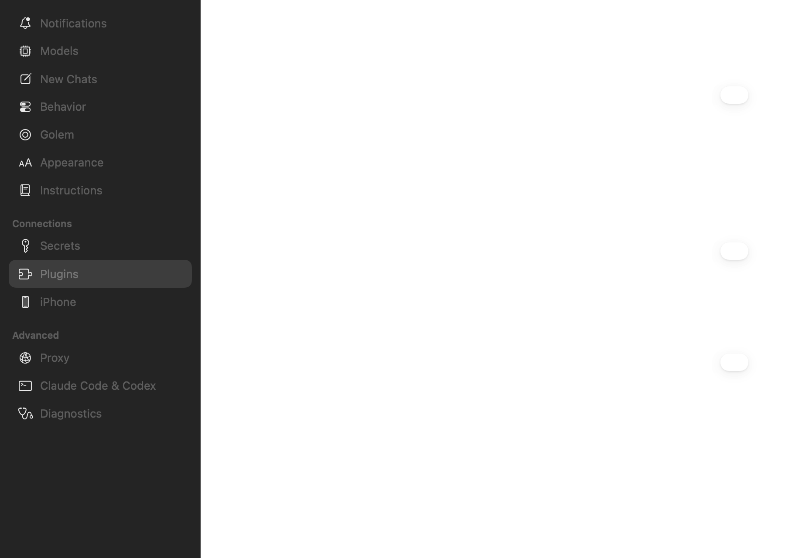
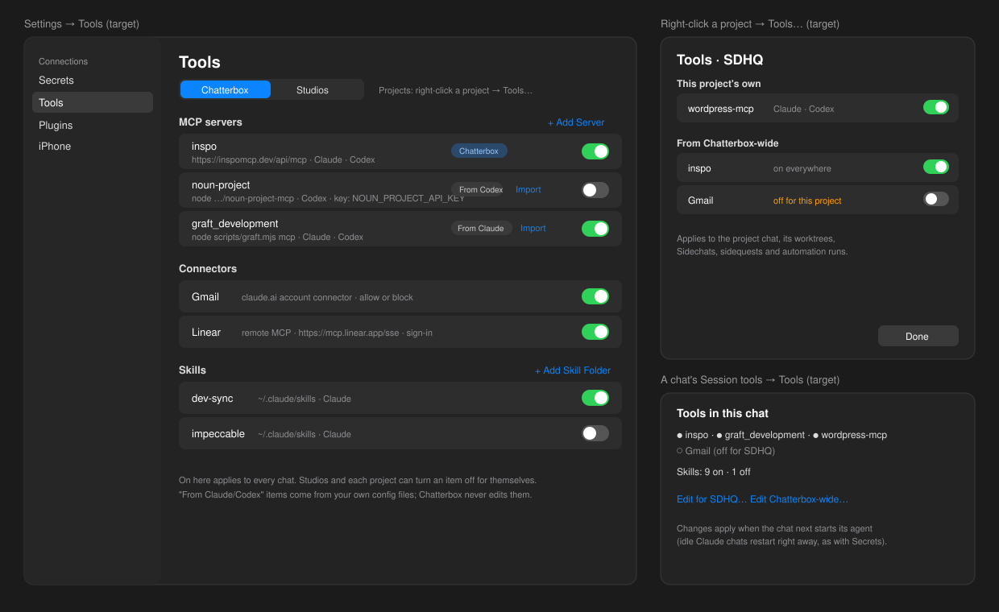
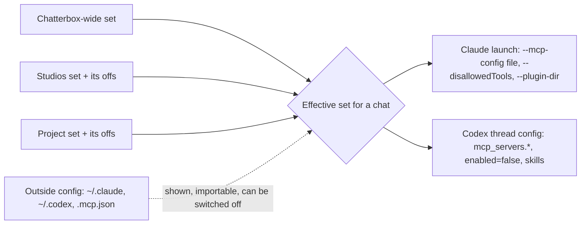

# Agent tools: MCP servers, connectors and skills, per level

Tracking: https://github.com/shelbyklein/chatterbox/issues/44 · related: #42 (idle agents and their MCP processes; every server added here is one more process per chat).

## Summary

Chatterbox gets one place to manage what its agents can use: MCP servers (local commands and remote URLs), connectors (claude.ai / ChatGPT account connectors, and remote MCP servers) and skills. There are three levels: Chatterbox-wide, Studios (one set shared by every Studio chat), and each project. They stack, and a project or Studios can turn off something it inherits from Chatterbox-wide. Setup that already exists outside Chatterbox is shown read-only, with an Import button.

## Problem

Today Chatterbox has no say in what tools its Claude and Codex chats load, so every chat gets the same tools, whatever the project.
- **Claude:** Claude Code is launched without `--mcp-config` (except Golem), `--strict-mcp-config` or plugin flags (`Core/Chatterbox/Engine/ClaudeCode.swift:87-108`). Every Claude chat loads whatever `~/.claude` and the project's own files set up.
- **Codex:** threads get only `model_provider` routing and the retired VM's servers switched off (`CodexRoute.swift:29`, `ChatComputer.swift:9-15`, `ChatSession+Codex.swift:264-297`). They inherit all of `~/.codex/config.toml`'s `[mcp_servers]` and skills.
- **Settings:** the only nearby page is **Plugins**, which holds Chatterbox's own features (Next Steps, Golem) (`PluginsSettingsView.swift`).
  
  The page's content draws blank in the test render; the sidebar shows where it sits.
- **Connectors:** the only connector awareness is Golem's allowed Gmail and Calendar tools (`AssistantConfiguration.swift:16-21`).
- **Secrets:** these are scoped to projects only, with no Studio level (`Secrets.swift:22-23`).

Who it affects: Shelby. A WordPress project and a design Studio get the same servers and skills. Servers only some places need (WordPress, Analytics, Stripe) are on, or off, everywhere. Turning one off means editing `~/.claude.json` or `config.toml` by hand.

Verified tool support (installed versions, Oct 13):
- **Claude Code 2.1.296:** `--mcp-config <files...>`, `--strict-mcp-config`, `--disallowedTools`, `--plugin-dir`, `--settings`, `--add-dir`.
- **Codex 0.162.1:** per-thread `config` overrides (already used), with `mcp_servers.<name>` tables and `enabled` flags.

Existing outside setup on this Mac:
- **Codex:** inspo, node_repl, cua_repl and graft (on); noun-project, google-analytics, computer-use and code-review (off).
- **Claude:** inspo and graft, plus the Stripe plugin's server.
- **Skills:** ~20 in `~/.claude/skills` and `~/.agents/skills` (listed in `config.toml`).

## Target

**Settings → Tools** (in Connections, beside Secrets):
- A scope switch: **Chatterbox | Studios**.
- Three sections, each a list of rows with an on/off switch:
  - **MCP servers**, with **Add Server**: a command, or a URL with an optional sign-in or key from Secrets. You choose which agents get it.
  - **Connectors:** account connectors (allow or block) and remote servers.
  - **Skills**, with **Add Skill Folder**.
- Rows from outside setup carry a **From Claude** or **From Codex** badge and an **Import** button.

**Right-click a project → Tools…:**
- The project's own items.
- Everything inherited from Chatterbox-wide, each with a switch to turn it off for this project.

**A chat's Session tools → Tools:**
- What's on in this chat, and where each item comes from.
- Links to edit that level.

Layering for a chat:
- **Project chat** (including its worktrees, Sidechats, sidequests and automation runs): Chatterbox-wide + the project's own − what the project turned off.
- **Studio chat:** Chatterbox-wide + Studios − what Studios turned off.
- **Other chats:** Chatterbox-wide.
- **Golem:** keeps its own tools; unchanged.

## Settled decisions

- **Levels:** three (Chatterbox-wide, Studios as one shared set, each project). They stack, and lower levels can turn off inherited items.
- **Outside setup:** shown read-only with Import. Chatterbox never writes `~/.claude*`, `~/.codex/config.toml` or a project's `.mcp.json`.
- **Connectors:** both account connectors (allow or block only; they're added on claude.ai or ChatGPT) and remote MCP servers by URL.
- **Placement:** Settings → Tools for Chatterbox-wide and Studios. Right-click a project → Tools… for that project. A Tools entry in Session tools for the open chat.
- **Storage:** Chatterbox's own `ToolScopes.json` in Application Support, keyed by scope (`chatterbox`, `studios`, `project:<folder>`). This follows the pattern of Automations and Secrets. Keys and tokens stay in the Keychain through the existing Secrets.
- **Applying changes:** idle Claude chats restart when their effective set changes, as Secrets do now. Codex threads reload through the existing configuration fingerprint (`codexConfigurationKey`).

## Success criteria

1. **Turning servers on and off per level:** a server added Chatterbox-wide is used by a fresh Claude chat and a fresh Codex chat. Turned off for one project, that project's chat doesn't get it while others do. Verified by `scripts/test-agent-tools.sh`, which checks the launch arguments and thread config with fixture agents, and once in the installed app.
2. **The Studios set:** it reaches Studio chats and no others. Verified by the same test.
3. **Outside setup:** it's listed with the right source and can be imported, and switching an outside item off removes it from a chat without touching the outside file. Verified by the test with a fixture home folder, plus a checksum of the outside files before and after.
4. **The three UIs** (Settings → Tools, project Tools…, Session tools) render with real data. Verified by render tests and the installed app.
5. **No change for chats with nothing set:** with no `ToolScopes.json`, launches are the same as today. Verified by the test comparing arguments with and without the file.

## Deliverables

- Engine:
  - `ToolScopes.swift`: the model, storage and effective-set resolver.
  - `ToolDiscovery.swift`: reads outside setup, read-only.
  - The apply step for Claude and Codex.
  - Status: committed.
- UI:
  - `ToolsSettingsView.swift`, the project **Tools…** sheet, and the Session tools entry.
  - Status: committed.
- Tests: `scripts/test-agent-tools.sh` and render tests. Status: committed.
- Mac app and service. Status: installed, with the service restart queued (standing approval).
- This plan and the GitHub issue, updated as tasks finish.

## Tasks

| ID | Task | Acceptance check |
|---|---|---|
| T1 | **Mechanism spike.** With fixture servers, confirm on the installed versions: (a) Claude `--mcp-config` adds to the outside servers, `--disallowedTools mcp__<name>` removes an outside server's tools, and `mcp__claude_ai_<Connector>` removes a connector; (b) how to turn off one Claude skill (a `--disallowedTools` Skill rule, or a generated `--settings` rule) and load an added skill folder (`--plugin-dir` holding a generated plugin); (c) Codex per-thread `mcp_servers.<name>` adds a server and `enabled=false` removes an outside one, plus how its skills and apps are switched off. Record the findings in this plan. | Each mechanism shown working, or a documented fallback, in a scratch run listing each agent's tools. |
| T2 | **Model and resolver.** `ToolScopes` and `ToolSet` (servers, connector allow/block, skill on/off, skill folders, offs of inherited items), stored in `ToolScopes.json`, with `effective(for: ChatSession)`. Shared by the app and service (added to the runtime sources). | Unit checks: layering for project, Studio, plain and Golem chats; offs; no file means an empty set. |
| T3 | **Discovery.** Read `~/.claude.json` and `~/.claude/settings.json` mcpServers, installed Claude plugins, `~/.claude/skills`, `~/.codex/config.toml` (`mcp_servers`, `skills`), and a project's `.mcp.json` and `.claude/skills`. Read-only. | A fixture home folder: every item listed with its source; the files are unchanged (checksums). |
| T4 | **Apply to Claude.** Write a per-chat MCP config file and pass `--mcp-config`. Pass `--disallowedTools` for the offs. Add skills per T1. Restart idle Claude chats when the effective set changes. | The fixture agent records its arguments: they match the effective set; no file means the same arguments as today. |
| T5 | **Apply to Codex.** Add the effective servers and offs to the thread config, include them in `codexConfigurationKey`, and handle skills and connectors per T1. | The fixture records the `thread/start` config; changing the set reloads the thread. |
| T6 | **Settings → Tools.** Chatterbox / Studios scope switch; the three sections; Add Server (command or URL, a key from Secrets, agents); Add Skill Folder; From Claude / From Codex rows with Import. | A render test with a fixture of each kind; adding and toggling saves to `ToolScopes.json`. |
| T7 | **Project Tools… and Session tools.** A right-click entry on a project (beside Automations…) opening the scoped panel with inherited rows; a Tools entry in Session tools showing the chat's effective set, with edit links. | Render tests; the right-click entry opens the panel; the Session tools list matches `effective(for:)`. |
| T8 | **Import.** Copy an outside item into a level, with keys moved into Secrets when its env has them; the outside copy is then switched off for Chatterbox chats, so nothing loads twice. | A fixture import: the item appears once in the effective set; the outside file is unchanged. |
| T9 | **Deliver and verify.** Install the Mac app (standing approval); queue the service restart (idle wait). In the installed app: add a Studios-level server, open a Studio chat and confirm the agent lists it; turn an inherited server off for SDHQ and confirm SDHQ's chat lacks it. | Observed in the installed app; reported with what was seen. |

Gates for Shelby:
- **Install and idle service restart (T9):** covered by the standing approval in AGENTS.md.
- **Interrupting replies:** a restart that would cut off running replies would need Shelby's go-ahead.

## Scope boundaries

- Not included:
  - Writing or editing skill contents.
  - Adding connectors on claude.ai or ChatGPT.
  - Golem's own tools.
  - The iPhone app.
  - Writing any outside config file.
  - Per-chat overrides; levels only.
- Must not change:
  - Chats with no Tools settings launch exactly as now.
  - Golem's MCP config.
  - Secrets' current project scoping and Keychain storage.
  - The Plugins page (Chatterbox's own features).
  - Next Steps' side calls (they already run with `--strict-mcp-config`).

## Test plan

- `scripts/test-agent-tools.sh` (new): T2 layering, T3 discovery against a fixture home, T4/T5 the launch arguments and thread config recorded by the fixture provider (`tests/golem-integration/fake-provider.py`, extended to record them), and T8 import.
- Render tests: `scripts/test-tools-settings.sh` (Settings → Tools and the project panel) and the Session tools entry. Real entry points: Settings → Tools, right-click a project → Tools…, a chat's Session tools.
- Regression: `scripts/test-sidequest.sh`, `scripts/test-chatterbox-daemon.sh`, `scripts/test-chat-toolbar.sh`, `scripts/check-sources.sh`.
- Installed-app check (T9).

## Rollback

- **Data:** the only new data is `ToolScopes.json`, plus per-chat generated MCP config files under the Host folder. Deleting `ToolScopes.json` returns every chat to today's behavior (success criterion 5).
- **Outside files:** never written, so there's nothing to restore. Before the first import, `ToolScopes.json` doesn't exist yet; T8's test confirms an import leaves outside files byte-identical.
- **Code:** revert the commits and reinstall. The service restart picks up the reverted engine.

## Open questions (not blocking)

- **T1's skill mechanism for Claude** may turn out to be a generated plugin folder rather than a flag. Either way the UI is the same.
- **Codex account apps/connectors:** if the installed Codex can't switch these off per thread, Connectors rows for Codex show as Claude-only until it can.
- **Remote servers that need OAuth sign-in:** the first version supports URL + key/token from Secrets. Servers needing a browser sign-in show **Sign in** and run the agent's own login (`claude mcp` / `codex mcp login`) if T1 shows that works per session; otherwise they're listed as "sign in from the agent's own settings".

## Work preparation

- **Confirmed scope:** in chat on 2026-10-13. Levels: stack with offs. Outside setup: show + import. Connectors: both. Placement: Settings tab + per-place panels.
- **Mode:** `linear`. The tasks share engine and view files and depend on T1–T2, so parallel lanes would collide.
- **Models:** executor Claude Opus 5.5 (`claude-opus-5-5`), this session's effort.
- **Now/later:** now (Shelby: "go for it, then execute the plan").
- **Readiness:** pass · 2026-10-13. R3 uses a code-referenced current state plus a sidebar render, and the target SVG and Mermaid flow. R12 is covered above.
- **Issue:** https://github.com/shelbyklein/chatterbox/issues/44
