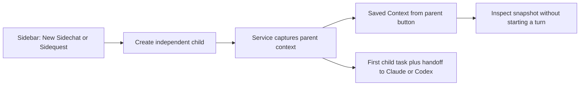

# Context when creating sidechats and sidequests

New Sidechat currently copies settings and folder but no conversation context. Sidequests send context invisibly with their task. Prepare a saved parent-context snapshot at creation for both, with a compact way to inspect it before typing, and deliver it with the child's first task.

Local tracking: `local:instructions/child-context-handoff.md`. Scope: the user's October 20 request to get context from the sidebar controls. Use the dev-plan/dev-work routine; no GitHub issue mutations.

## Current and target

Current: `ChatSession.sidechatRecord` returns an empty, independent conversation; `sidequestRecord` alone sets `pendingHandoff`. Mac creation uses a partial UI projection; the service has the complete parent record. Current control layout: `build/verification/sidechat-cards-installed.png`.

Target UI: a single `Context from “Parent”   View handoff` row above the child transcript; click opens a bounded, selectable read-only popover. No copied messages fill the child transcript.

## Success criteria / deliverables

- Both child types save source identity, folder, brief, recent conversation with file paths, and relevant tool names at creation; the handoff is a bounded excerpt, not a model-generated summary. Test bounds, empty parents, nested children and persistence.
- The service rebuilds a new child's snapshot from its authoritative parent, regardless of how little the UI loaded. Test runtime insertion from a deliberately incomplete client record.
- Both providers get context with the first task; a new provider also receives inherited context after switching. No extra provider turn starts just to create or inspect a sidechat. Preserve sidequest return routing and automation isolation.
- Mac inspection opens from the real New Sidechat control. Build, scoped commit/push, install/reopen, and queue the service restart under standing approval; distinguish queued activation from live verification. No iOS UI or TestFlight change is needed for this Mac sidebar request.

## Work preparation

Mode: linear; the shared record builder, service insertion and Mac display form one dependency chain. Executor: current session; exact model/effort unavailable. Readiness: pass, R1–R13 covered here; R7 local checklist below, no remote issue. No blocking questions.

Preserve parent history, running agent, draft, provider settings and independent child provider IDs. No migration of old children, automatic parent summarization turn, expanded permissions, or automatic execution of a sidechat. Automation runs continue to receive only their automation instructions. New optional fields decode old records; navigation summaries must strip the snapshot. Rollback: revert scoped commits and reinstall/idle-restart; existing conversation files are not migrated or rewritten en masse, and old binaries ignore the optional field.

## Tasks and checks

- [x] H1 Shared context: bounded snapshot, inherited handoff and provider switching; test `scripts/test-sidechat.sh` and `scripts/test-sidequest.sh`, including captured provider input.
- [ ] H2 Runtime/UI: service replaces partial client context; compact read-only Context control, native click and rendered proof in the sidechat test; verify real installed entry point.
- [x] H3 Delivery: source check, Mac build, scoped Core/root commits and pushes, install/reopen, default idle service restart, tidy report. Record actual availability separately.

Validation: both focused suites pass (`build/child-context-runtime-test.log`, `build/child-context-ui-test.log`). Runtime tests observe the actual Claude and Codex fixture inputs, authoritative service context, sidequest return and automation isolation. Native UI test creates a child from the sidebar icon, opens the context row, verifies no provider starts, and checks persistence. Inspected render: `/tmp/chatterbox-sidechat.72aWKm/context-handoff.png`. Source check and full Mac build pass (`build/child-context-mac-build.log`). Installed verification remains pending under H2/H3.

Delivery: Core `81acf00`, root implementation `e803cff`, both pushed to main. `scripts/ship.sh` installed/reopened the app; installed service binary matches the build. CUA confirmed the reopened app's New Sidechat control advertises the context handoff and restored Building Chatterbox. The new service is queued with default idle waiting (report: October 20, 13:47:51); live creation/inspection against the updated service remains pending under H2 until replies finish. Full creation/inspection and first-message delivery passed in isolated native/provider fixtures. Stable inspected proof: `build/verification/child-context-handoff.png`. Tidy report `build/child-context-tidy.txt`: historical removable items reported, none removed.
