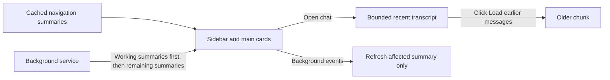

# Load navigation before transcripts

The Mac currently requests forty display items plus provider bookkeeping for every conversation, then requests the selected conversation in full. The observed 281-session response was 5.2 MB; startup and global configuration/creation refreshes apply every record to the UI. Load bounded summaries for navigation, recent messages for visible chats, and earlier messages only when requested.

## Work preparation

Scope confirmed by Shelby: “DO IT”, October 20, 2026, following the summary-first loading proposal. Mode: linear, because wire format, projection and transcript paging depend on one another. Executor: current session; exact model/effort unavailable. Tracking: local:instructions/lazy-session-loading.md; no GitHub issue mutations requested. Readiness: pass, R1-R13 checked; R7 uses local tracking. No blocking questions. Routine install/reopen and idle-safe service restart have standing approval in AGENTS.md.

## Flow

## Success criteria

1. Summary lists contain zero transcript rows, drafts, or host replay state; fixtures retain titles, ownership, provider, waiting state, previews and image paths. Compare serialized summary and legacy payload sizes.
2. Startup can show a cached navigation list before the connection; only selected/visible chats request transcripts. Background progress never fills unopened transcripts. Exercise the real AppModel against an isolated daemon.
3. Recent messages, older paging, switching, reconnects, new/empty chats, drafts and pending questions remain correct; stale list replies never replace newer state.
4. Existing daemon tests and focused projection tests pass; Mac build installs with matching executable. Record idle-safe service activation separately.

## Deliverables and tasks

- [x] T1 Add compatible summary-list capability and bounded transcript paging; old clients retain their existing list/get behavior. Check serialization and paging in daemon/fixture tests.
- [x] T2 Project summaries, restore navigation cache, and hydrate only visible transcripts. Preserve notifications, previews, cards, context-menu actions, selection and draft behavior. Check isolated UI projection, reconnect and event races.
- [x] T3 Wire earlier/history requests and loading feedback; verify the rendered selected-chat entry point and paging without fetching unrelated history.
- [x] T4 Run regression checks, commit and push scoped Core/root changes, install/reopen Mac, queue idle-safe service restart, and report measured results plus activation status.

## Boundaries and rollback

Mac loading only; no mobile release, default-provider change, provider-process lifecycle change or conversation migration. Keep stored transcripts, provider handoff/replay, questions, drafts and concurrent work intact. New cache contains only reconstructable summaries; ignore/remove it to recover. Capability negotiation keeps a new Mac compatible with the currently running older daemon. Roll back binaries/source to the recorded parent commits if needed; authoritative chat storage is unchanged and is not rewritten by the cache.

## Validation

Run scripts/test-chatterbox-daemon.sh and a focused scripts/test-lazy-session-loading.sh using an isolated store and fake providers. Verify startup cache, selected-chat hydration, background events, smaller payload, recent/older pages, configuration resync, metadata actions and reconnect. Build via scripts/ship.sh, inspect its selected-chat loading render, then compare installed executable. Restart only with scripts/restart-service.sh and default idle wait. Run scripts/tidy.sh as a report only.

## Verification so far

- Foundation daemon regression suite passed, including provider replies, replay, questions, ownership and idle lifecycle (scripts/test-chatterbox-daemon.sh).
- First focused projection run passed: 40 conversations, 900 messages in selected chat, 39 unopened transcripts empty; navigation 16,349 bytes versus legacy 8,017,748 bytes; fixture startup about 0.10 seconds. This is fixture evidence, not a timing claim for Shelby’s installed app.
- Selected-chat render inspected: recent transcript and a pending question outside its loaded tail both visible; sidebar populated from summaries. Proof: ../design/lazy-session-loading/selected-chat.png.
- Final focused run passed all 42 checks, including working/completion Activity, rename/eviction, archive, Studio-new-chat, cached startup, and old-protocol transition checks. Debug fixture startup was 0.13 seconds; list payloads were 8,017,851 bytes (legacy) versus 16,452 bytes (summaries). This is not an installed-app timing claim.
- Final Mac Debug build and source/diff checks pass. Activity previews and menu-bar recents also use navigation summaries. The rendered selected-chat proof was inspected again.
- Tidy report completed without deletions; unrelated older artifacts remain for a separate cleanup.

## Delivery

- Core e447278 and app/service d61c312 are committed and pushed to their respective main branches.
- scripts/ship.sh passed, installed and reopened the Mac app, and verified its executable matches the build. The installed service executable also matches the build.
- scripts/restart-service.sh queued the default idle-safe restart at 12:15:50 EDT on October 20. The live service was healthy but still advertised the old capabilities when checked; the summary path activates after this restart, then reconnects automatically. No active reply or agent host was stopped.
- This changes Mac navigation and transcript loading. The service remains the authoritative owner of conversation history; no storage migration or mobile release is included.

## Explicit history follow-up, October 20

Shelby asked to keep very little text visible and explicitly request each earlier chunk. Scope: Mac transcript only, linear execution in this session; no blocking questions or GitHub issue changes. Keep twelve recent display rows on entry, reveal up to twelve more per click, and remove automatic loading when the top enters view (including the older-macOS delayed expansion). Fetch forty stored items for entry and each ordinary older request instead of eighty and two hundred respectively. Grouped tools can occupy fewer display rows. Find, message-pin jumps and All Images/Files remain explicit full-history requests; stored/provider history is preserved.

- [x] Remove scroll-triggered history expansion; keep the reading position stable on explicit local and remote prepends.
- [x] Verify scrolling to the top twice does not expand history, one click reveals a small chunk, entry/older network requests stay bounded, switching returns to the small tail, and typing dots remain visible.
- [x] Build, commit/push scoped changes, install/reopen the Mac app, inspect the rendered button and run the tidy report. No service restart or iOS release is needed for this client-only follow-up.

Verification: scripts/test-history-on-scroll.sh passes all 23 checks, including a native click that grows the transcript from 765 to 1,452 points while preserving the previously top message. scripts/test-lazy-session-loading.sh passes the projection suite plus real UI clicks against an isolated daemon: entering the top does nothing, cached rows reveal before another request, and one later click fetches exactly forty older items. Mac Debug build, source synchronization and diff checks pass. Inspected proof: ../design/lazy-session-loading/manual-history.png. Tidy report completed without deletions.

Delivery: Core 8456e3f and app 990d3f0 are pushed. scripts/ship.sh installed/reopened the Mac app and confirmed the executable matches the build. Inspected the installed Building Chatterbox session: the recent transcript, working indicator and Load earlier messages button are present, with older history left behind the button. Both focused suites passed (23 and 47 checks); no background service or agent process was restarted.
