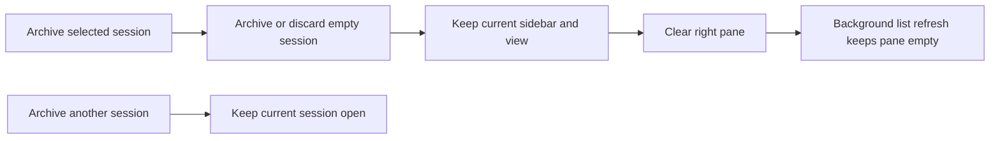
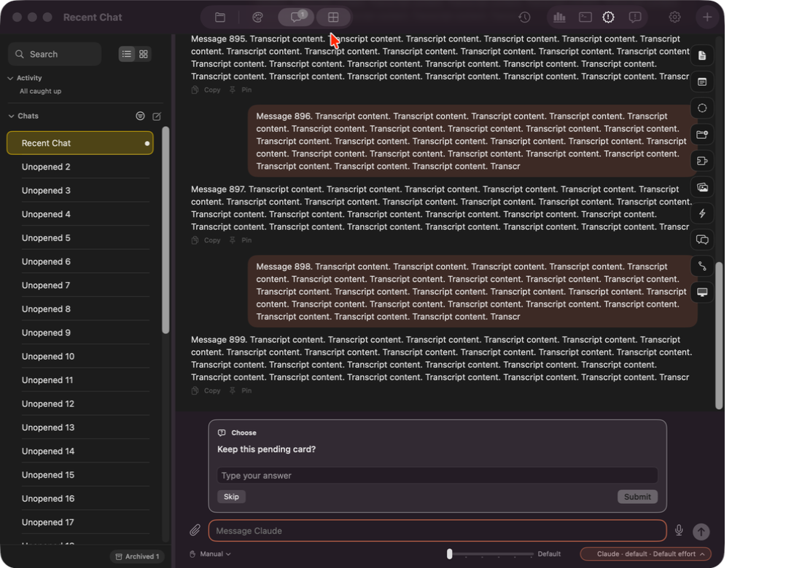
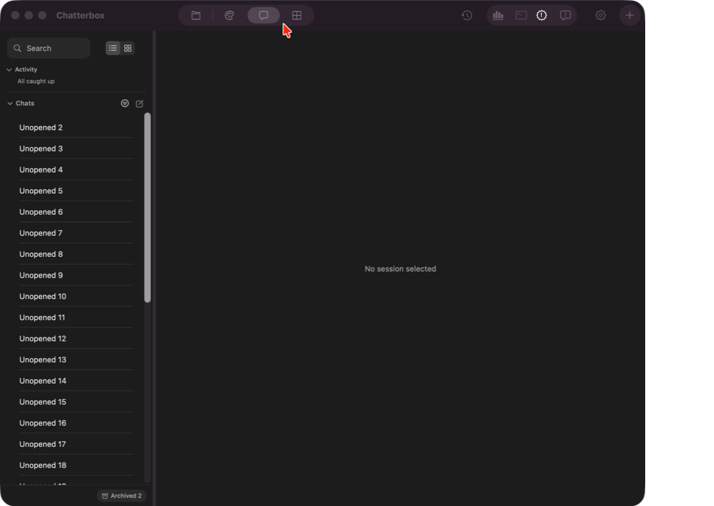

# Keep the Mac view when archiving

Archiving the selected Mac session currently selects another active session, or creates a new chat when none remain (`AppModel.archive`). Selecting that replacement can change the sidebar section. The requested behavior is to leave the current view/sidebar in place and show the existing “No session selected” detail.

Work preparation: confirmed by “ok so do it”; tracking `local:instructions/mac-archive-selection.md`. Linear, because implementation, tests and installation depend on each other; current session, exact model/effort unavailable. Dev-plan/dev-work readiness passes R1–R13: R3 is the control-flow sketch above; no blocking questions or delegation. Routine Mac delivery is authorized by AGENTS.md. No issue is being created or closed.

Success: selected archives preserve Projects, Chats, Studio and overview navigation; other-session archives leave the current session alone; archiving the last/empty session creates no replacement; daemon list refresh does not reopen a session. Verify using isolated native Mac toolbar tests plus the isolated daemon/lazy-loading regression. Inspect the rendered empty pane alongside the retained sidebar.

Deliverables: scoped Core change, regression tests and evidence committed/pushed; Mac app built, installed and reopened. No iOS change, service restart, provider behavior change, schema migration, deletion of user data or unrelated cleanup. Preserve normal Delete behavior, empty-chat cleanup, initial startup restoration and deliberate session selection. Rollback: revert the scoped source commit and reinstall; archive storage format is unchanged and archived chats remain recoverable. Tests use disposable copies, never archive a user's real sessions.

- [x] M1 Implement archive-specific empty selection and preserve navigation; inspect source/diff.
- [x] M2 Run `scripts/test-chat-toolbar.sh` and `scripts/test-lazy-session-loading.sh`; inspect new Mac archive proof and run `scripts/check-sources.sh`.
- [x] M3 Commit/push Core then root, install using `scripts/ship.sh`, verify installed executable/running process, run `scripts/tidy.sh` report only.

Verification: `build/mac-archive-toolbar.log` reports all 13 new archive checks passing (Projects, Studios, Chats, other-session/overview, final session and empty-session cleanup). Its full result is 59 passing and one failing unchanged toolbar-order assertion: the expected suffix omits the already-existing Feedback button. That unrelated assertion was left unchanged, so this suite is not claimed fully green. `build/mac-archive-daemon.log` reports 50 passing checks and exits zero, including service-confirmed archive, a preferences-triggered list refresh that keeps selection empty, and explicitly opening another session afterward. The archive confirmation waits for the asynchronous command to reach the service.

The actual native ContentView before/after was captured in the isolated daemon test and visually inspected. It retains the Chats sidebar, removes the archived row and shows “No session selected” on the right. Toolbar harness screenshots were blank and are not used as visual evidence. These are fixture captures, not an archive operation on a user's real conversation:

Mac Debug build and `scripts/check-sources.sh` pass. Tidy report `build/mac-archive-tidy.log` lists 40 removable, 0 kept; no cleanup applied. No iOS build or service restart is needed for this Mac selection change.

Delivery: Core `9152583` and root source/tests `4c11ef0` are committed and pushed to their respective `main` branches. `scripts/ship.sh` completed successfully (`build/mac-archive-ship.log`): installed/reopened Chatterbox, verified the installed executable matches the built executable and verified the installed app process is running. User-session archive behavior was tested only with disposable fixtures; no real session was archived for verification.
