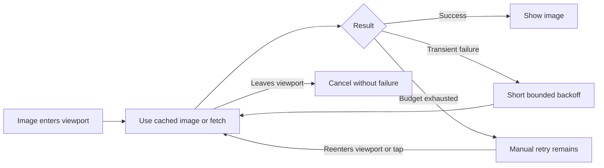

# Retry visible session images on iOS

Session images currently make one download attempt and then require a tap after any failure. `RemoteImage.load()` also uses `try?`, so cancellation when a lazy transcript row disappears becomes the same failure state as a real network error. Automatically load/retry an image when it enters view, with a bounded retry budget and cancellation when it leaves; keep manual retry for persistent failures.

## Work preparation

Tracking: `local:instructions/mobile-image-retry.md`. User requested immediate repair; routine internal TestFlight delivery has standing authorization in AGENTS.md. Mode: linear, because the loader, fixture validation and delivery depend on each other. Executor: current session; exact model/effort unavailable. No delegation or GitHub issue mutations. Readiness: pass, R1–R13 covered here. No blocking questions.

This is a loading/control-flow repair with the existing image, spinner and failure UI retained. Simulator screenshots will document real rendered success and persistent-failure states; no visual redesign is planned.

## Success and scope

- A visible image recovers from an initial HTTP failure without a tap; verify actual iPhone/iPad session UI and fixture request counts.
- Automatic attempts stop after a small budget while continuously visible; leaving cancels work without marking a cancellation as a failure. Returning starts another attempt; manual retry still works. Verify persistent failures, scrolling away/back and a slow cancelled request in the isolated fixture.
- Retain cache reuse, original-image viewing/copy/markup, transcript scroll intent, lazy history, authentication and GET-only behavior. No changes to uploads, mutations, daemon, desktop, GIF/video/PDF loading, account secrets or stored transcripts. iOS 18+ uses actual scroll visibility; iOS 17 retains appearance-based lazy loading as compatibility fallback.

Deliverables: scoped Core loader fix and root regression tests/plan committed/pushed; signed universal iOS archive uploaded and available to the existing internal Shelby TestFlight group. No Mac install/service restart is needed for a mobile view-only change. No tester expansion or public release.

## Tasks

- [x] M1 Add isolated image fixture/UI checks. Baseline `build/mobile-images-baseline.log` makes only one request after the deliberately failed response and fails automatic-recovery acceptance. Fixture artifacts: `build/mobile-images.w5Bvwv`. Acceptance: baseline fails automatic recovery after a deliberately failed first response, independent of production data.
- [x] M2 Implement visibility-aware bounded retries and cancellation handling. Acceptance: iPhone and iPad fixture checks pass for automatic recovery, budget, reentry/manual retry and cancellation; inspect real screenshots and run source checks.
- [ ] M3 Commit/push and deliver TestFlight. Acceptance: archive/upload successful, Apple processing valid, build available to existing internal group; tidy report run without deleting unrelated work.

Test commands: `scripts/test-mobile-images.sh iphone`, `scripts/test-mobile-images.sh ipad`, `scripts/check-sources.sh`, `scripts/testflight.sh`, `scripts/testflight-status.py <build>`. Use canonical build folders and automatic cleanup; fixture runs only on localhost. Open the session from the real Projects list and inspect the loaded image and fallback screenshots. Compare bounded request counts before/after scrolling and cancellation. Run existing mobile scroll checks if the change touches transcript coordination.

Rollback: revert scoped Core/root commits and distribute a new numbered TestFlight build; the previous available build remains selectable. No schema/data migration or backup is needed because only transient view state changes. Device installation/acceptance is separate from TestFlight availability.

Validation: `build/mobile-images-iphone.log` / `build/mobile-images.3ffXup/results.xcresult` and `build/mobile-images-ipad.log` / `build/mobile-images.XiMRiE/results.xcresult` each pass four UI tests, zero failures. Inspected real simulator captures in `design/mobile-image-retry/`: `iphone-recovered.png`, `iphone-fallback.png`, `iphone-after-cancellation.png` and `ipad-recovered.png`. They show actual fixture image pixels after automatic recovery and cancellation/reentry, and the retained manual fallback after the retry budget. Request counts verify that transient failure takes two requests, persistent failure stops at three, recovery on reentry/manual retry uses one further request, and the older offscreen image is not fetched. Cached reentry issues no further request. `scripts/check-sources.sh`, harness shell syntax and fixture Python syntax checks pass. Transcript coordination was not modified, so the existing scroll suite was not repeated.
