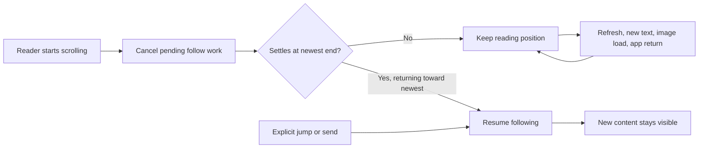

# Preserve the iOS reader's position

When someone scrolls upward to read an older reply, that position should remain theirs until they return to the newest message or explicitly send/jump there. The current transcript already gates streamed revisions by follow intent, but unconditionally pins on scene activation and every appearance; it also relies on a simultaneous drag gesture to revoke follow intent. These paths can override a reader who is away from the end.

## Work preparation

Tracking: `local:instructions/mobile-reading-position.md`. Scope: enforce the user's requested reading/follow rule in the mobile transcript; investigate current iOS first, with an optional platform clarification pending. Immediate repair is authorized; routine internal TestFlight delivery is standing-approved by AGENTS.md. Mode: linear, because reproduction, coordination changes and delivery depend on each other. Executor: current session; exact model/effort unavailable. No delegation or GitHub issue mutations. Readiness: pass, R1–R13 covered here; no blocking decision. If the user identifies Mac, inspect that path before claiming their symptom fixed.

This is a scroll/control-flow repair with the current transcript and jump button retained, not a visual redesign. Actual simulator screenshots will show the reading anchor retained across the reproduced event.

## Success and delivery

- Reproduce a forced jump in the current app through a real UI action, then verify the same visible message/vertical position survives that event on iPhone and iPad.
- Reader scrolling cancels pending automatic work; stream/refresh and app reactivation respect stopped following. Returning to the end or tapping Jump resumes following. Verify existing mobile scroll suite plus focused lifecycle and reading tests.
- Preserve first opening at the newest messages, multiline composing/sending, reading during a delayed send, image retry behavior, cache, lazy transcript loading, stored transcripts and API/authentication contracts.

Deliverables: scoped Core fix, root UI regression and evidence/plan committed/pushed; signed iOS build uploaded and available to the existing internal Shelby TestFlight group. No new testers/public release. No Mac/service changes unless the platform clarification identifies a separate desktop fault.

## Tasks

- [x] M1 Add a lifecycle regression and reproduce the current forced jump. Acceptance: current iPhone UI moves the recorded visible reading anchor on reactivation.
- [x] M2 Correct follow ownership and verify. Acceptance: all current and new scroll checks pass on iPhone/iPad, rendered reading proofs inspected, source check passes. Include image/loading scenarios where relevant to a reproduced jump; do not claim unmeasured causes.
- [x] M3 Commit/push and deliver. Acceptance: signed archive/upload succeeds; Apple processing and existing-group availability explicitly verified; tidy report only.

Tests: `MOBILE_SCROLL_ONLY=testReadingPositionSurvivesReactivation scripts/test-mobile-scroll.sh iphone` for baseline; `scripts/test-mobile-scroll.sh iphone` and `scripts/test-mobile-scroll.sh ipad` for acceptance; `scripts/check-sources.sh`; `scripts/testflight.sh` and `scripts/testflight-status.py <build>`. All UI traffic uses the existing localhost fixture and canonical derived-data folders; own fixture processes/simulators clean up on exit. Actual entry point is the Projects session row, then scroll to a visibly hittable earlier reply and trigger the event. Inspect exported simulator screenshots and compare the same message's vertical frame before/after; accessibility existence alone cannot pass.

Exclusions: history pagination policy, desktop redesign, provider/model settings, image-cache redesign, writes/retries, secrets, daemon lifecycle and unrelated cleanup. No schema/data changes; rollback is the scoped commit revert plus a new numbered TestFlight build, with the previous build still selectable. No data backup/migration is required. Physical-device installation and acceptance remain separate from tester availability.

Baseline: `build/mobile-reading-baseline.log` / `build/mobile-scroll.jVYkzF/results.xcresult` reproduces the forced jump after Home → app activation: `Returning to the app pulled the reader to the bottom`. The UI test selects a genuinely visible earlier answer before leaving. Both unconditionally scrolling lifecycle handlers are now gated by existing follow intent; only a new transcript view gets the unconditional opening pin. Existing gesture/generation cancellation is retained pending the full regression checks; no speculative drag rewrite is included.

iPhone acceptance: `build/mobile-reading-iphone.log` / `build/mobile-scroll.Yzg8lT/results.xcresult` passes all five tests, zero failures. Inspected the actual captures in `design/mobile-reading-position/`: `iphone-before.png`, `iphone-after.png`, `iphone-after-refresh.png`, `iphone-after-preview.png`. The same older answer stays at the same vertical position after app return and refresh/streaming; the image stays at the same position after closing its viewer. The jump button remains available while reading. Existing multiline send, send/drag takeover and streaming/jump checks also pass. No response to the optional platform question yet; continuing with iOS based on the immediately preceding mobile issue.

iPad acceptance: `build/mobile-reading-ipad.log` / `build/mobile-scroll.lmYktO/results.xcresult` passes all five tests, zero failures. Inspected `design/mobile-reading-position/ipad-after-refresh.png`: the earlier reply remains in view while the newer streamed reply stays below it and Jump remains available. `scripts/check-sources.sh` and both root/Core diff checks pass. The correction is limited to first appearance versus reappearance, and respecting existing follow intent on scene activation. No image loader, scroll geometry, send behavior, transcript storage or networking changes are included.

Additional image-layout acceptance: the focused `testReadingPositionHoldsWhileTallImageLoads` passes on iPhone (`build/mobile-scroll.1EDEbu/results.xcresult`) and iPad (`build/mobile-scroll.FL2gxo/results.xcresult`), one check per device, zero failures. A held image request is observed before releasing the 320-by-960 PNG; the older answer retains its vertical frame within one point after expansion. Both `iphone-after-tall-image.png` and `ipad-after-tall-image.png` were visually inspected. This rules out an extra forced jump in the tested image-loading flow; no further app change was needed. Across the initial suite and focused follow-up there are six passing checks per device, twelve total.

Delivery: Core `9b9d166a7e14dabeb757076f05afadf070044f4c` and source integration `eeac5be4c5666f6ca58b38b345e63b596ed1fbdb` are pushed. Signed universal iOS build `1.0 (202610211235)` uploaded successfully. Apple reports `VALID` and `IN_BETA_TESTING`; fresh API reads confirm association with the existing internal `Shelby` group. Physical-device installation remains unverified. Additional image tests change only the harness and evidence, so the uploaded app still matches the verified Core source. No Mac installation or service restart is needed. Tidy report `build/mobile-reading-tidy.log` lists 218 removable, 0 kept; no apply/deletions performed. Release details are recorded in `design/mobile-reading-position/delivery.json`.
