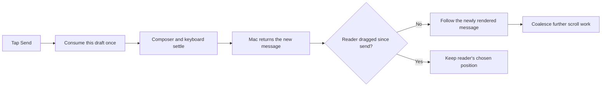

# Keep the iOS transcript in place when sending

Sending a message on iOS makes the session text jump away. Reproduction found two related faults: the keyboard and tall draft could hide the latest reply before sending snapped back to it, and an already prefetched/cached chat wasn't marked initially loaded. The first subsequent revision therefore forced a first-load scroll, even after the reader dragged away. The trace in `build/mobile-scroll.QxYv6U/scroll.log` shows the acknowledgment retaining the changed drag generation and `following=0`, immediately followed by the unconditional first-load pin.

## Work preparation

Tracking: `local:instructions/mobile-send-scroll.md`. Immediate repair follows the user's bug report. Scope: stable sending and following in the iOS transcript, retaining deliberate reading/dragging and the existing Golem message-anchor behavior. Mode: linear because reproduction, the shared view correction and delivery depend on each other. Executor: current session; exact model/effort unavailable. No delegation or GitHub issue mutations. Readiness: pass, R1–R13 covered below. An optional question about the observed jump is pending; stable send/reading behavior can be tested independently.

This is a scroll/control-flow repair with no visual redesign. The diagram records the target flow; simulator screenshots from the real send entry point will document the rendered result.

## Success and deliverables

- Sending short or multiline drafts keeps the newest message in the visible transcript as the composer shrinks and the keyboard stays open. Verify using the real iPhone UI and a delayed companion fixture response, not just a final static snapshot.
- Scrolling to read cancels queued automatic movement; streaming still follows from the bottom, and Jump to Newest restores following. Verify existing scroll regressions plus a send/drag race. iPad uses the same behavior and must pass its focused run.
- Scope the fix to mobile scroll coordination; preserve drafts, message delivery, transcript storage, lazy loading, provider settings and Golem's existing newest-user-message anchor. No Mac daemon or API changes.
- Commit/push Core and root tests/docs; produce a signed Release archive, upload to the existing internal TestFlight group under standing authorization, then verify processing and tester availability separately. No new testers or App Store release. No Mac reinstall or service restart is needed for a mobile-only view change.

## Tasks

- [x] M1 Reproduce and strengthen the mobile scroll regression. Baseline `build/mobile-send-scroll-baseline-viewport.log` fails `growing the draft hid the newest reply before sending` in the actual iPhone UI. The pre-send screenshot shows Answer 28/Question 29 while Answer 30 is below the expanded composer; send then snaps to the end. Earlier multiline send and streaming tests passed, so those alone missed the pre-send displacement. Corrected stale Projects navigation and selected a genuinely visible reading anchor; a held response makes the send/drag race deterministic. All traffic uses localhost fixture port 47410.
- [x] M2 Implement the correction supported by the reproduction. iPhone/iPad scroll regressions pass for sending, streaming and user takeover (three tests per device); source check passes and rendered simulator results are inspected.
- [x] M3 Commit/push and deliver through TestFlight. Core `580d23b` and root `ec86dfd` pushed; signed universal archive/upload succeeded for **1.0 (202610210809)**. Apple reports **VALID / IN_BETA_TESTING** and the build is explicitly associated with the existing **Shelby** internal group. Device installation/acceptance remains unverified. Tidy report completed: 182 older removable items, no apply/removal of unrelated work. No Mac install or service restart required.

Test commands: `scripts/test-mobile-scroll.sh iphone`, `scripts/test-mobile-scroll.sh ipad`, `scripts/check-sources.sh`, then `scripts/testflight.sh` and `scripts/testflight-status.py <build>`. Reuse `build/DerivedData-MobileTests`, `build/DerivedDataMobile` and `build/TestFlight`. Extend existing fixture tests rather than create duplicate app builds. Inspect the send screen and any failure screenshots; tests must not infer visible position from accessibility existence alone.

Rollback: revert the scoped mobile Core/root commits and distribute the prior mobile behavior in a new numbered TestFlight build; existing testers can also select an earlier available build. No data schema or stored transcripts are changed, so no data backup or migration is required. Existing source history and the current available build remain rollback points.

Exclusions: desktop scrolling, background-service lifecycle, history limits, model switching, general iOS redesign, credential access, unrelated tests/cleanup, publishing or expanded tester access. Optional symptom detail is the only open question; no blocking product decision remains.

Implementation: separate the reader's follow intent from temporary bottom visibility; follow composer/focus resizing, measure the settled scroll position using the existing visible-rect calculation, retain the true bottom margin in the target, coalesce queued pins, limit the jump-button animation to its overlay, and follow an acknowledged send only if no reader drag intervened. Mark details already available at opening as loaded. A drag toward older messages remains in control even inside the bottom tolerance; returning toward the newest messages or tapping Jump resumes following, and Jump stays available while following is stopped. Lazy rows, draft ownership, send API and Golem's newest-user-message anchor are retained. Temporary tracing has been removed. An early held-response test exceeded the client's six-second timeout; the final test uses one settled drag and releases before the timeout, with an explicit no-timeout assertion. A trial bottom-inset subtraction was rejected because it left Jump visible after a successful jump; the final calculation retains `visibleRect.maxY`. `MOBILE_SCROLL_ONLY=<test method>` can focus the existing isolated harness.

iPhone acceptance: `build/mobile-send-scroll-final-validation-iphone.log` / `build/mobile-scroll.EKtA9y/results.xcresult`, three tests passed, zero failures. Inspected `design/mobile-send-scroll/iphone-composing.png`, `iphone-sent.png` and `iphone-reading.png`: latest reply visible above the tall composer; complete sent draft above the keyboard; earlier reading position retained after acknowledgment. iPad acceptance: `build/mobile-send-scroll-final-validation-ipad.log` / `build/mobile-scroll.N0KDFa/results.xcresult`, three tests passed, zero failures. Inspected `design/mobile-send-scroll/ipad-sent.png` in the actual split-view send flow, with the complete message above the keyboard. `scripts/check-sources.sh` passes. Release and Apple/group evidence are in `design/mobile-send-scroll/delivery.json`; upload log is `build/mobile-send-scroll-testflight.log` and tidy report is `build/mobile-send-scroll-tidy.log`.
