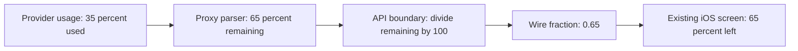

# Correct iOS proxy usage percentages

The iOS Usage screen reads fractions from the companion API, but the server passes proxy quota percentages directly into that field. Live output confirms values of 28, 65, 37 and 93 where the API contract requires 0.28, 0.65, 0.37 and 0.93; the phone clamps these to 100% left. Fix the unit conversion at the server boundary so the installed iOS app receives accurate numbers.

## Work preparation

Tracking: `local:instructions/mobile-usage-percentages.md`, local only. Immediate repair is authorized by the user's report. Mode: linear; one narrow serialization correction and regression. Executor: current session; exact model/effort unavailable. Readiness: pass, R1–R13 covered here. Optional clarification about which values looked wrong is pending; the reproduced percentage defect is independently actionable.

## Success and delivery

- Provider percentages serialize as fractions: 65% left becomes 0.65, 0%/100% retain their meanings, and unknown stays nil. Verify the real shared Codable payload from parsed provider quota with `scripts/test-proxy-quota.sh`.
- Direct agent windows, reset dates, account status and Mac usage displays retain their existing meanings. Regression covers both providers and the old parser cases; `scripts/check-sources.sh` and full Mac build pass.
- Commit/push the scoped Core/root fix, install/reopen the Mac app and queue an idle-safe service restart under standing approval. The already installed iOS screen understands the corrected API; no mobile binary or TestFlight upload is needed.

## Tasks

- [x] U1 Add an explicitly named percentage-to-fraction serializer and use it for proxy windows. Acceptance: provider parsing through shared JSON encode/decode produces exact expected percentages, reset dates and unknowns, including values below 1% remaining.
- [ ] U2 Run regressions, source check and full build; commit/push, install and queue service restart. Acceptance: `scripts/ship.sh` confirms installed executable parity; report queued versus activated status accurately.
- [ ] U3 Record results and run tidy in report mode. Acceptance: verification and remaining activation status documented, no unrelated cleanup.

No new quota estimation, account routing, provider authentication, refresh policy, usage aggregation, UI layout or historical data changes. Live proxy data also contains genuine unavailable-account responses (HTTP 401), which must remain visible rather than be invented as zero/full quota. Latest agent-reported limits remain a separate existing source; broader freshness work requires evidence of a separate defect.

Rollback: revert the scoped commits, reinstall with `scripts/install.sh` and queue an idle-safe service restart. No stored data is rewritten, so no migration/backup is needed. Tests are behavioral serialization checks, because the current screen layout is unchanged. Activation may wait for active replies; never interrupt them without approval.

## Verification

- Live authenticated companion response confirmed proxy fractions of 28, 65, 37, 100 and 93, while the direct Codex window correctly used 0.07. No account credentials or identities retained in evidence.
- `scripts/test-proxy-quota.sh`: pass (`build/mobile-usage-test.log`). For Claude and Codex, provider parsing through API JSON encode/decode verifies 0%, 28%, 65%, 37%, 93%, 100%, 0.5% and unknown remaining. Existing iOS display math gives the expected percentage, reset timestamps round-trip, and direct limit fractions remain unchanged. Existing quota parser cases also pass.
- `scripts/check-sources.sh`: pass. No new target source files or project regeneration needed.
- Full Mac app/service build: pass (`build/mobile-usage-mac-build.log`).
