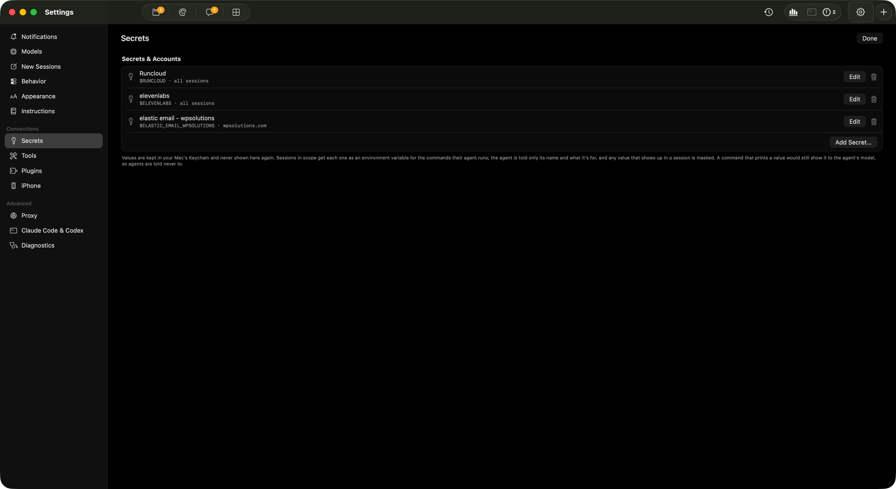
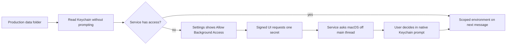

# Restore saved secrets to background sessions

RunCloud's `$RUNCLOUD` key is present in Keychain and scoped to all sessions, but the production service treats any `CHATTERBOX_DATA_DIR` override as test mode. Its launch agent sets that variable to the real application-support directory, so it reads a nonexistent test credential file instead of Keychain. Keychain also trusts the window app separately from `chatterboxd`; the app currently neither reports service access nor offers native authorization for it.

## Work preparation

Tracking: `local:instructions/secret-background-access.md`. Scope: repair the reported missing saved credential, preserve existing scopes and Keychain values, and expose service availability with an explicit native authorization action. Immediate repair follows the user's bug report and standing delivery authorization. Mode: linear, because storage, service and settings changes depend on each other; executor: current session, exact model/effort unavailable. No GitHub issue mutations. Readiness: pass, R1–R13 covered below. No blocking product decisions. A native Keychain approval, if needed, remains the user's action.

## Current and intended flow



Target row sketch:

```text
key  Runcloud                       Available to sessions     Edit  Trash
     $RUNCLOUD · all sessions

key  Runcloud                       Allow Background Access   Edit  Trash
     $RUNCLOUD · all sessions

macOS may ask you to approve chatterboxd. No key is displayed.
```



## Success and delivery

- Canonical production data paths use Keychain, including an explicit override and normalized aliases. Isolated test folders retain fixture-file storage. Verify a behavioral regression against the real vault.
- Saving/removing secrets refreshes the daemon's metadata and values; idle Claude processes get updated environments and active replies are left running. Codex keeps its existing next-message configuration refresh. Verify reload, scope, redaction and configuration fingerprints.
- Settings reports background availability without exposing values; only the signed Chatterbox UI may request native authorization for a single entry. No secrets enter RPC bodies, replies or command receipts. Verify daemon access checks, full build, and installed Settings rendering.
- Commit/push scoped Core and root changes, install/reopen the Mac app, and queue the default idle-safe service restart. Report activation separately. No iOS binary changes or TestFlight upload are required.

## Tasks

- [x] S1 Correct storage selection and add safe reload/explicit Keychain authorization. Acceptance: regression covers canonical/isolated folders, persistence, reload, scope and redaction without reading production values.
- [x] S2 Connect signed-UI-only status/authorization to Secrets settings and next-message provider refresh. Acceptance: unsigned/agent roles are denied; status contains IDs and booleans only; successful authorization retains the key only in memory.
- [ ] S3 Run regression, source check and Mac build, then commit/push and install. Acceptance: installed executable matches build; inspected Settings screenshot shows real status or honestly reports the older service awaiting restart.
- [ ] S4 Queue idle-safe activation, record results and run tidy in report mode. Acceptance: no active replies interrupted, no unrelated cleanup or credential changes.

Exclusions: RunCloud API operations, server/site changes, key replacement, scope widening, automatic Keychain ACL edits, shell-based Keychain workarounds, new plaintext production storage and unrelated cleanup. No existing secret data is migrated or rewritten by reload. Never print a value, put it in a transcript, or persist it in an RPC receipt.

Tests: `scripts/test-secrets.sh`, `scripts/check-sources.sh`, full Mac `xcodebuild` using `build/DerivedData`, and real Settings → Secrets via computer use. The regression uses only an isolated fixture folder and disposable test values. Native permission dialogs remain for the user; a rendered button is not evidence of granted access.

Rollback: revert scoped Core/root commits, reinstall using `scripts/install.sh`, and queue `scripts/restart-service.sh` with its default wait. No credential migration, deletion, or ACL write is performed, so no secret backup is necessary. Existing Keychain entries and scopes remain authoritative.

## Verification

- `scripts/test-secrets.sh`: pass, `build/secret-background-tests.log`. Actual vault regression covers production override/path aliases (selection only, without reading production values), isolated fixtures, separate-cache refresh, scope inheritance, key rotation/fingerprints, redaction, targeted authorization, malformed metadata and removal.
- `scripts/test-secrets.sh --wire`: pass, `build/secret-background-wire.log`. Real built daemon in an isolated store rejects unsigned UI, agent/Golem availability and authorization requests; approved test UI receives only entry IDs/booleans; missing keys and removed entries update correctly; no credential or these read operations enter persisted command receipts. Temporary fixture executable removed using shared guarded cleanup.
- `scripts/check-sources.sh`: pass, `build/secret-background-sources.log`. No target files added, so no project regeneration required.
- Full Mac app/service build: pass, `build/secret-background-mac-build.log`. Existing Keychain API deprecation and unrelated project warnings remain; no compile errors.
- Installed UI rendering, production activation and native Keychain approval remain pending. No production values printed, extracted to files or sent through RPC; no scopes changed.
