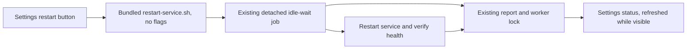

# Restart the background service from Settings

Chatterbox has no in-app restart control: Settings → Diagnostics currently lists reports only (see [current capture](../design/service-restart/before.png)). Add a Background service section above those reports, with connection status, a Restart Background Service button, and live queue/result feedback. The button runs the existing bundled scripts/restart-service.sh with no flags, preserving its idle wait and single queued job.

## Work preparation

Scope authorized by Shelby's request, October 20, 2026. Tracking: local:instructions/service-restart.md. Mode: linear, because the launcher and settings control share one small flow. Executor: current session; exact model/effort unavailable. Readiness: R1–R13 pass; current UI captured, target sketched below, no blocking questions. Routine verified install/reopen is standing-approved by AGENTS.md. No GitHub issue changes.

## Target sketch and flow

```text
Diagnostics
  Background service
    Connection                         Connected
    Restart Background Service         [Restart Background Service]
    Waits for active replies to finish. The app reconnects automatically.
    Waiting for active replies to finish.             [Show Restart Report]
  Diagnostics
    Existing reports…
```



## Success criteria and delivery

1. Settings → Diagnostics exposes the restart action and explains the wait; inspect the installed native UI and capture it.
2. Clicking invokes only the shared script with no immediate/host options, cannot stack clicks while queued, and reports launch failures; test against owned fake scripts, never stop live work for testing.
3. Queue, restart, success, failure, and stale-worker states are readable after reopening Settings; exercise isolated report/lock fixtures.

- [x] T1 Implement the launcher/status reader and bundle the existing script; pass isolated behavioral tests.
- [x] T2 Add the native Settings section and regenerate the project; Mac build and installed UI check pass.
- [x] T3 Commit/push scoped changes, install/reopen, capture the control, and run tidy as a report. No service restart is needed just to add the button.

## Boundaries, rollback, and tests

Mac only; no immediate restart option, provider-host termination, mobile release, data migration, or change to the restart script's safety behavior. Isolated development builds cannot operate installed services. Rollback is the previous app build/source; no authoritative chat data changes or backup migration is needed. Run scripts/test-service-restart.sh, scripts/check-sources.sh, the Mac build via scripts/ship.sh, then inspect Settings → Diagnostics through native UI. Keep screenshots in design/service-restart/ and report service activation separately from installation.

## Verification

All 14 isolated behavioral checks pass: no-flag launcher (including a path containing spaces), duplicate-click prevention, queue/restart/success/failure states, reopening Settings, stale workers, timeout, isolated-build guard, missing helper, and launcher errors. The Mac Debug build passes and its bundled script matches scripts/restart-service.sh byte for byte. Installed UI inspection and delivery follow.

## Delivery and installed verification

- Core 82a81f0 and app 5ab4fb4 are pushed. scripts/ship.sh installed/reopened the app and verified its executable; the installed restart helper matches the shared script.
- Inspected the installed Settings → Diagnostics control. It recovered the previous successful restart at 12:16 and displayed the connection correctly. Clicking the actual button at 12:23:18 queued the bundled script without flags; the button disabled and status changed to “Waiting for active replies to finish.” [Installed proof](../design/service-restart/installed.png).
- Confirmed the live worker command is /bin/bash /Applications/Chatterbox.app/Contents/Resources/restart-service.sh. The test restart is queued until replies finish; no active agent or reply was stopped.
- Tidy report completed with no deletions. No mobile release or additional service implementation change is required.
