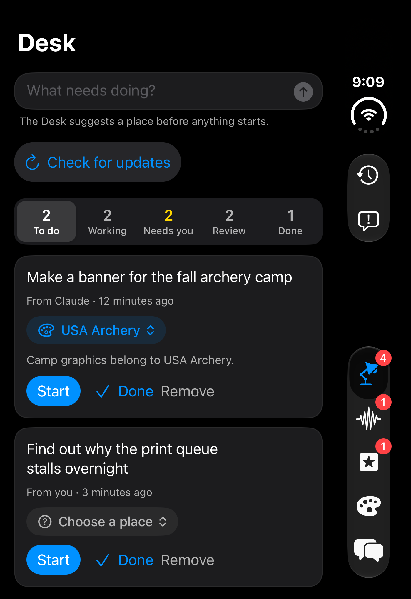
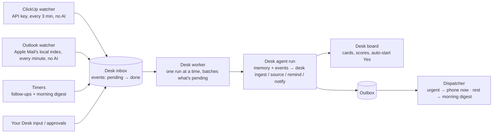

# Always-on Desk

Issue: https://github.com/shelbyklein/chatterbox/issues/72

## Summary

Today the Desk learns about new work only when you press **Check for updates** (or a routine runs). That starts one large agent run that re-reads all of ClickUp and Outlook. This plan makes the Desk **always on**, following Anthropic's ["Building always-on agents"](https://claude.com/resources/articles/building-always-on-agents) (2026-11-13):
- **Inbox:** the Mac watches ClickUp and USA Archery Outlook and drops each change into an event inbox.
- **Short runs:** a Desk agent wakes for each batch, updates the board and starts preparing clear work.
- **Memory and timers:** it remembers what it has told you, and sets its own follow-ups.
- **Outbox:** it tells you only what matters, plus a morning digest.

## Problem

- **Nothing flows in by itself.** New ClickUp tasks, comments and emails wait until someone runs the check. The check is one big run (the "USA Archery Updates" routine, `Automations.json`, run by `DeskStore` through `deskSourceRoutine`/`deskSourceInstructions`). It re-reads every open task and the day's mail, then works out what's new from coverage checkpoints in old reports (`ProjectAutomations.swift:61-100`).
- **Partial checks are common, and they show.** Today's Desk header reads "Check incomplete · ClickUp: other workspaces… Outlook: … not fully verifiable… checkpoint unchanged." The agent has no durable memory of where each source left off.
- **No follow-ups.** The Desk can't set itself a "check back on this" ("did Callie reply by Tuesday?").
- **No pacing.** Changes appear on the board silently, or not at all. There's no short "here's what changed" and no rule for what deserves a notification.
- **Already in place, and reused:** de-duplication by source reference, `desk ingest` manifests, `desk source` status updates, Yes/No preparation scoring, and auto-start of Yes tasks (`DeskStore.autoStartWaiting`, two at a time, Settings → "Start Desk tasks that can run without you").
- **Who it affects:** Shelby, on the Mac and the phone.

Current Desk (phone, test fixture): "Check for updates" is a manual button.



## Target



On the Desk, the "Check for updates" row becomes a status line:

```
●  Watching ClickUp · Outlook   ·   checked 2 min ago            [Check now]
   3 changes today · next digest 8:30 AM
```

## Decisions (settled, Shelby 2026-11-21)

- **Sources:** ClickUp (USA Archery workspace) and USA Archery Outlook. Gmail is not included.
- **Arrival:** the Mac checks, with no public server.
  - **ClickUp:** every 3 minutes through its API, using the saved `CLICKUP_API` secret. No AI involved.
  - **Outlook:** ~~a small Claude check through a connector~~. T1 found there's no connector: checks drove the Outlook app on screen. **Revised:** Shelby adds the USA Archery account to Apple Mail, and the watcher reads Mail's local index every minute, with no AI. Push may come later.
- **Autonomy: prepare the work.** The Desk updates or adds cards, scores them, and lets existing auto-start begin preparing clear Yes tasks. Sending, posting and changing ClickUp always wait for you.
- **Telling you: quiet plus a digest.** The board updates silently. A phone notification goes out only for things that need you or have a deadline within 48 hours. A short morning digest comes at 8:30 on weekdays.

## Success criteria

1. **A new ClickUp task or comment shows up on its own.** A task assigned to Shelby, or a new comment on one, appears or updates on the Desk within about 5 minutes, with nobody pressing anything. *Verified live in Chatterbox Dev on a real task, and by the inbox and watcher tests with a fake ClickUp.*
2. **A new USA Archery email shows up on its own.** It becomes a card, or updates one, within about 25 minutes during working hours. *Verified live in Dev with a test email.*
3. **Nothing appears twice, and nothing is lost.** The same change is never processed twice. A crash or service restart mid-run loses no events. *Verified by the inbox tests: restart mid-run, duplicate source IDs.*
4. **Notifications follow the rules.** An urgent item sends a phone notification. Everything else waits for the 8:30 digest. Nothing is repeated that `reported.md` says was already told. *Verified by the outbox tests and a live morning digest in Dev.*
5. **Cost is lower than today's checks.** In a one-day live trial, the AI spend for an always-on day is below one of today's full "Check for updates" runs plus routines. *Verified from Usage and the run log.*

## Deliverables

- **Service code:**
  - `DeskInbox`: durable events, de-duplication, one worker, batching.
  - Watchers: `ClickUpWatcher` and `OutlookWatcher`.
  - `DeskTimers`: follow-ups, and the digest schedule.
  - The Desk agent session and its memory folder.
  - `DeskOutbox` and its dispatcher.
  - *All committed and pushed.*
- **CLI:** `desk remind` (set or clear a follow-up) and `desk notify` (an outbox message with urgency). *Committed.*
- **UI:**
  - The Desk status line on Mac and phone.
  - Settings → Desk: always-on switch, working hours, digest time.
  - The phone digest notification.
  - *All committed.*
- **Tests:**
  - `scripts/test-desk-inbox.sh`, covering inbox, timers, outbox, and the watchers with fake ClickUp and Outlook.
  - Updates to `test-desk.sh`.
  - *Committed and passing.*
- **Changelog lines.** *Committed.*
- **Install:** Chatterbox Dev first, because this adds saved data and a new service loop. A one-day live trial follows. *Installed in Dev; real install after Shelby taps **Ship**.*

## Tasks

| ID | Task | Acceptance check |
|---|---|---|
| T1 | **Probe both sources, read-only.**<br/>**ClickUp:** use the API with `CLICKUP_API` to list tasks assigned to Shelby updated since a time (`date_updated_gt`), plus their new comments. Record the fields and rate limits.<br/>**Outlook:** run a `claude -p` check on a small model with the Outlook connector that returns JSON (message id, from, subject, received time, snippet) for mail since a checkpoint. Measure its time and tokens. | `plans/assets/always-on-desk/probe.md` has real sample payloads (redacted) and the measured cost of one Outlook check. No writes anywhere. |
| T2 | **Desk inbox and worker.**<br/>Events go in `Desk/inbox.json`: id, source, sourceEventID, kind, payload, receivedAt, status (pending, running, done, failed) and attempts.<br/>Events are de-duplicated by `sourceEventID`, and only one run is active at a time. Pending events are batched with a 60-second settle.<br/>Events arriving mid-run wait for the next run. A crash mid-run leaves its events `running`, and they're retried on start (at most 3 attempts, then `failed` with a Desk notice). | `test-desk-inbox.sh`: duplicates are dropped; a batch of 3 makes one run; a restart mid-run retries the same events once; one active worker. |
| T3 | **ClickUp watcher.**<br/>Polls every 3 minutes while always-on is on. It keeps its own checkpoint in `Desk/checkpoints.json`, which only moves forward after a complete, successful page-through.<br/>It emits `task.new`, `task.updated` (status, priority, due date or description changed) and `comment.new` events. It ignores changes Shelby made herself.<br/>It backs off on rate limits and on errors. | Tests against a fake ClickUp server: new, updated and comment events; the checkpoint only advances on full success; a 429 backs off; Shelby's own edits are ignored. |
| T4 | **Outlook watcher, through Apple Mail** (decided 2026-11-21 after T1: USA Archery mail is only in the new Outlook app, which can't be scripted).<br/>**Gate: Shelby adds the USA Archery account to Apple Mail** (Microsoft Exchange). Mail syncs it, and the watcher keeps Mail running hidden (`open -gj`), because Mail only syncs while it's open.<br/>Every minute it reads Mail's `Envelope Index` **read-only** for that account's Inbox, finding messages received since the checkpoint (sender, subject, summary, received time, message id). Each becomes an `email.new` event, de-duplicated by Mail's message id.<br/>No AI, and nothing in Mail is changed. If the account is missing or the index is unreadable, it reports that on the status line. | Tests with a fixture Envelope Index (a SQLite copy with sample rows): events created; the checkpoint advances; the account filter works; a missing account sets the status without crashing. Live check after Shelby adds the account. |
| T5 | **Desk agent and memory.**<br/>A dedicated general "Desk" session runs each batch.<br/>**Memory** lives in `Desk/memory/`:<br/>• Loaded every run: `instructions.md` (seeded from the current USA Archery Updates rules: read-only, priorities, standing context), `reported.md` (what's been told), and `index.md`.<br/>• Read when needed: `notes/` and `progress/`.<br/>**Prompt:** the run gets the batched events and memory. It must use `desk list --json`, `desk ingest`, `desk source`, `desk remind` and `desk notify`, never act outbound, and write back to memory.<br/>**Model:** Sonnet 5.5 at medium effort, to keep it cheap; changeable in Settings. | A stand-in run test: the events reach the prompt; memory files are loaded; a successful ingest marks events done; a failed run leaves them pending for retry. A live Dev run on one real event. |
| T6 | **Timers.**<br/>`desk remind TASK --at TIME [--note]` stores follow-ups in `Desk/timers.json`. The digest is a built-in schedule (weekdays at 8:30, set in Settings).<br/>A one-minute scheduler turns due timers into inbox events, then marks follow-ups done or moves schedules on. Timers never start runs themselves. | Tests: a follow-up fires once; a schedule moves to its next occurrence; a timer that came due during sleep fires once on wake, not once per missed minute. |
| T7 | **Outbox and dispatcher.**<br/>`desk notify --urgency urgent|digest TEXT [--task ID]` adds to `Desk/outbox.json`.<br/>The dispatcher sends urgent items as a phone push right away (needs you, or a deadline within 48 hours), and collects the rest into the morning digest: one push, plus a Desk "Since yesterday" card.<br/>Each sent item is appended to `memory/reported.md`. No pushes in quiet hours, except urgent ones, which wait until 7 am. | Tests: urgent sends immediately; digest items are combined into one push; an item already reported isn't sent again; quiet hours hold urgent items until morning. |
| T8 | **UI.**<br/>• **Desk status line** (Mac and phone): what's watched, last checked, the next digest, a source problem if any, and **Check now** (runs both watchers immediately). It replaces the long "Check incomplete…" text.<br/>• **Settings → Desk:** the always-on switch (default on after Ship), working hours, digest time and the agent's model. | A Mac render test, and a phone `MOBILE_TEST_ONLY` Desk test with a screenshot of the status line; the existing `testDeskSourceCheck` is updated. |
| T9 | **Verify, Dev, live trial and Ship.**<br/>Run `tests-for.sh --run --fail-fast --since <base>`, then `install-dev.sh` and `install-phone.sh --dev`.<br/>**Gate: a one-day live trial in Dev with Shelby.** Real ClickUp and Outlook, the cost compared against today, and a digest received.<br/>**Gate: Shelby taps Ship.** Then the real install. The old routine stays off but kept, as the fallback. | All focused tests pass. The trial report lists events seen, cards changed, notifications sent and AI spend. A ship report with installs and service health. |

## Exclusions and what stays the same

- **Not included:** Gmail; push delivery (webhooks, forwarding, Cloudflare Worker); drafting replies.
- **No writes to sources:** nothing is sent, posted, moved, marked read, or changed in ClickUp or Outlook. The existing approval-only write-back offers stay as they are.
- **The Desk stays as it is:** board columns, scoring rubric, auto-start limit (two at a time), de-duplication rules and source-linked tasks.
- **The USA Archery Updates routine** stays in Automations as a manual fallback. "Check for updates" keeps working, now as **Check now**.
- **Only the Mac:** watchers run only while the Mac's service runs. A closed lid means checks resume on wake, with no catch-up storm.

## Test plan

- **New:** `scripts/test-desk-inbox.sh`, a headless engine test of the inbox, watchers (fake ClickUp HTTP server, fake `claude` for Outlook), timers, outbox and the worker with stand-in runs.
- **Existing:** `test-desk.sh`, `test-automation-routines.sh`, `test-chatterbox-daemon.sh`, `test-mac-desk.sh`, plus the phone Desk tests `testDeskSourceCheck` and `testDeskFirstTab` via `MOBILE_TEST_ONLY`.
- **Rendered checks:** the status line on Mac (render test) and phone (screenshot inspected), entered from the Desk tab.
- **Live (Dev, gated):**
  - a real ClickUp comment on a test task appears within 5 minutes;
  - a test email appears within 25 minutes;
  - an urgent push and the 8:30 digest arrive;
  - the AI spend is measured.

## Rollback

- **Turning it off:** Settings → Desk always-on off stops the watchers and the worker immediately. The board is untouched.
- **New data:** `Desk/inbox.json`, `timers.json`, `outbox.json`, `checkpoints.json` and `memory/` are new files. Deleting them, or rolling back, leaves the Desk as today. Before the first real install, back up `desk.json`.
- **The app:** `scripts/rollback.sh` restores the previous Mac app and service. Dev is tried first.

## Open questions (none blocking)

- **The Outlook check's real cost and reliability through the connector.** T1 measures this. If it's poor, the fallback is a less frequent check, or adding push later.
- **ClickUp "changed" fields.** Which ones matter enough to wake the agent? T1 samples them; the default is status, priority, due date, description and new comments.

## Work preparation

- **Confirmed scope:** Shelby, 2026-11-21.
  - Sources: ClickUp and USA Archery Outlook.
  - Arrival: Mac checks.
  - Autonomy: prepare the work.
  - Telling you: quiet plus a digest.
- **Plan:** this file.
- **Mode:** `linear`. The inbox is shared by every later task, and the watchers, worker and outbox all touch `DeskStore` and the service loop, so parallel lanes would collide.
- **Models:** the current session (Claude Opus 5.5, `claude-opus-5-5`); exact effort not exposed.
- **Gates:** T9 live trial in Dev (Shelby); T9 Ship (Shelby).
- **Readiness:** pass · 2026-11-21 · R1–R13 pass (R3: current screenshot, status-line sketch, flow diagram; R12: off switch, new files only, rollback.sh, Dev first).
- **Now or later:** not yet decided.
