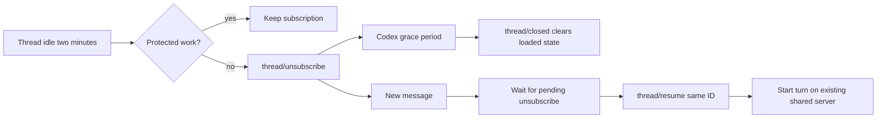

<!-- codex-idle-threads-2026-10-13 -->
# Release individual idle Codex thread subscriptions

The shared Codex server currently stays alive while any Codex chat is busy, retaining idle threads and their helpers (ConversationRuntime.releaseIdleAgents). Codex supports thread/unsubscribe and closes threads after its no-subscriber inactivity grace period of 30 minutes. Chatterbox should unsubscribe each safe idle thread after two minutes, resume the same thread before a later message, and preserve active chats on the shared process.

Scope authorized by Shelby: "okay continue" following the unsubscribe/resume proposal. Preserve provider history IDs, transcript, draft, settings, pending cards, queued messages, background work, remote-control sessions, and host replay. No archive/delete, custom Codex grace-period override, separate server per chat, forced interruption or unrelated UI work.

## Flow

## Success and deliverables
An idle thread unsubscribes while another thread keeps replying; guarded threads stay subscribed. Successful unsubscribe is persisted across service restarts. Returning messages resume the same thread and cannot race pending unsubscribe; closure notifications clear loaded state. Failures/timeouts keep the thread usable and do not imply released memory. Tests verify multi-thread behavior, guards, closure, resumption and restart; Mac build/install and internal TestFlight delivery follow standing approval. Codex controls actual unload timing; verify protocol behavior and avoid claiming immediate helper release.

## Tasks
- [x] T1 Add subscription and in-flight unsubscribe bookkeeping plus resume/closure handling; acceptance: resume waits for unsubscribe and persistent state distinguishes loaded/subscribed.
- [x] T2 Extend idle sweep and multi-thread integration regressions; acceptance: idle thread releases while active thread survives on same process, original ID/draft/history preserved.
- [ ] T3 Build, commit/push, backup/install and queue activation; acceptance: built and installed binaries match; report activation and TestFlight separately.

## Test and rollback
Run scripts/test-chatterbox-daemon.sh, scripts/check-sources.sh, Mac build in build/DerivedData. Use isolated fake-provider thread state and request logs to verify ordering and restart. Back up installed app and conversation/runtime data before activation. No migration: new optional subscription metadata permits older resume-state readers. Roll back scoped core commit and parent pointer, reinstall through scripts/install.sh.

## Work preparation
Mode: linear; current session, exact model/effort unavailable. Reason: lifecycle/RPC state changes need sequential implementation. Recipient: current session. Now authorized. Open questions: none. Readiness: pass R1-R13; flow embedded, rollback and tests above. Issue URL: https://github.com/shelbyklein/chatterbox/issues/43

Source: https://developers.openai.com/codex/app-server/ (thread/unsubscribe and thread/closed, fetched 2026-10-13).

## Verification
Multi-thread integration passed: idle unsubscribe while another thread remains active, same shared process and provider history, transcript/draft preservation, persisted unsubscribe metadata, pending per-thread RPC guard, in-flight message ordering, failure recovery and thread closure. Existing protected-work/replay/host cleanup tests also pass. Mac build passed. Core commits: a93b9a1 and 478077b (chat-save/replay ordering). Subscription state persists automatically after chat records, without a test-forced save. Mac installation verified for initial build; final replay-safe build installation in progress. Service/empty-host handoff waits for active work. Backup: /Users/shelbyklein/Library/Application Support/Chatterbox/Backups/codex-idle-threads-20261013-132804. TestFlight build 202610131328 uploaded; Apple processing pending.
