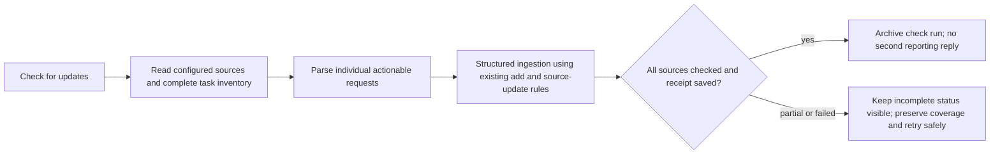

<!-- desk-check-ingestion-2026-11-06 -->
# Source checks update the Desk and finish quietly

Shelby wants Check for updates to parse each actionable request into individual Desk tasks, update existing ones, and dismiss the check's thread. The current header always links the last automation run through Open check, even when it is archived (`DeskStore.sourcePullState`, Mac `DeskView`, iOS `MobileDesk`). Manual-check instructions describe findings but do not require a structured successful ingestion receipt; the automation sidequest then starts another agent reply in the General reporting chat (`ChatSession.returnSidequest`).

Current screen: [supplied phone capture](../design/desk-check-ingestion/before.png). Preserve the existing header and board styling. Target:
```
[Check for updates] → [Checking…] → Checked just now · 2 added · 3 updated
                               ↘ Check incomplete · Outlook unavailable [retry via Check for updates]
[To do | Working | Needs you | Review | On hold | Done]
```


Success criteria: (1) fixture source findings produce separate persisted tasks and update existing IDs without resetting Working/Review/On hold/Done; (2) ingestion retries do not duplicate items, and no successful receipt appears before writes persist; (3) successful manual check archives its own run with no parent agent turn; partial, failed and legacy runs are never called successful; (4) Mac/iOS headers show inline outcome without Open check, while normal task navigation remains; (5) source/tests/captures committed and pushed, then Mac/phone Dev installed with fresh health checks. No real source review during validation.

- [x] C1 Add optional per-run check/result data and structured ingestion via `desk ingest FILE`, resolving the check from --chat or CHATTERBOX_CHAT_ID. Acceptance: validate the manifest before applying it, use existing stable-identity add/source update logic, save a receipt of actual task IDs/counts, apply each manifest atomically and make retries idempotent and distinguish unavailable sources. Old payloads/saves decode; ordinary agents cannot finish an unrelated/non-check run.
- [x] C2 Mark manual Desk source runs, require direct ingestion in their instructions and finish their lifecycle quietly. Acceptance: only a persisted complete receipt allows successful archival; missing/partial results remain incomplete, successful checks do not sendAutomatic to the parent, normal project/General automations and sidequests retain behavior. No extra source/model run is started for proof.
- [x] C3 Remove Open check in Mac/iOS headers and show inline successful/partial/failed/legacy status. Acceptance: existing buttons, checking feedback and task links remain usable; old services are not misreported as successful; readable native rendered states verified.
- [x] C4 Run focused engine/CLI/codec, sidequest/automation and native Mac/iPhone/Duo checks, inspect captures. Acceptance: create/update/zero-change, duplicate retry, invalid manifest, save/completion failures, interruption/partial state, ordinary automation regression and UI navigation proven with fixtures and no live connectors/models.
- [ ] C5 Commit/push Core then parent; install Mac Dev and reachable paired Dev phone. Acceptance: back up Dev Desk state; safe default Dev restart, fresh health/capabilities; actual phone install/open reported separately. Real delivery needs a new Ship. Keep issue open for acceptance.

Deliverables: existing-file code changes, CLI contract and regression fixtures, this plan, native captures and delivery proof, all committed/pushed to main; compatible Dev Mac/phone products installed. No new source file planned; regenerate the project only if one becomes necessary. Scope is manual Check for updates. Preserve configured schedules, IDs, agents, reporting destinations and ordinary scheduled automation behavior; preserve task identity, progress, held state, coverage checkpoints and prepared work. No source writeback, outbound send, live morning review, bulk cleanup of existing report chats, real deployment, TestFlight or unrelated animation fixes. Do not archive a reporting parent or a user task merely to hide the check.

Verification: `scripts/tests-for.sh --why` and focused `--run --fail-fast` on changed files; extend `test-desk.sh`, `test-sidequest.sh`/`test-automation-routines.sh`, CLI fixture coverage, `test-mac-desk.sh`, focused `test-mobile-home-nav.sh iphone` and `duo`. Enter through Desk → Check for updates; inspect success and incomplete header captures and ensure no Open check. Baseline parent `4f5cde2`, Core `2ca56b9`; latest release batch has 11 passed, known chat-switch failure, 100 unrun. Do not repeat the broad suite for this Dev change. Rollback: scoped revert and compatible Dev reinstall; pre-install Dev Desk backup stays outside version control, preserve existing conversation data and optional receipt fields. Do not downgrade active held-task data into an older service unaware of holds.

Work preparation: requested directly during the active implementation/shipment thread; settled outcome is direct individual Desk ingestion and dismissing successful check runs. Implement now after completing the authorized On hold/Recent shipment (completed and recorded). Linear: ingestion, lifecycle and both headers share one state contract. Model: current session; exact model/effort unavailable. Readiness: pass R1–R13; no blocking questions. Tracking: https://github.com/shelbyklein/chatterbox/issues/60.


Verification complete before Dev delivery: engine/CLI final log `build/desk-check-ingestion-engine-final.log` passes atomic individual create/update, durable receipts, Review/On hold/Done preservation, duplicate retry, changed completed-manifest refusal, partial-source recovery, missing receipt, zero-change success, existing-only mode, write failure rollback, permissions, real CLI RPC and distinct partial CLI exit status. No source/model run. Normal sidequest round trip passes with scripted fixture providers (`build/desk-check-ingestion-sidequest-final.log`). General/project automation suite passes (`build/desk-check-ingestion-automations-final.log`), preserving config bytes and proving the typed run marker/explicit ingestion run ID. Initial attempts caught an outdated automation test stand-in and a lightweight-engine dependency; the stand-in now uses the real record factory and the service supplies durable receipt lookup through RuntimeHooks. Those failed attempts are not called green.

Native Mac Desk suite passes and fresh success/incomplete header captures were inspected; normal task navigation and On hold tests in the same suite remain intact. iPhone 17 Pro/iOS 26.2 source-check flow passes (13.067 s); Duo/iOS 27.1 passes (20.194 s): checking disables duplicates, no Open check, saved counts appear inline, individual imported request is reachable in To do, partial coverage stays visible and retry remains available. Current headers/captures are unchanged by the final runtime-hook boundary fix, which was reverified by the engine/sidequest tests. Source lists, Python syntax and both diff checks pass. [Captures and details](../design/desk-check-ingestion/validation.md).
