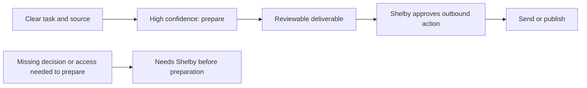

<!-- desk-preparation-confidence-2026-11-06 -->
# Score Desk preparation independently of outbound approval

A clear task can be prepared confidently even when Shelby must approve its eventual publication or follow-up. The current Desk rubric and both agents' intake instructions incorrectly classify any outward-facing final step as No. Shelby's supplied card explicitly says preparation is bounded but uses publication approval as its only blocking reason.

Evidence: `Core/Chatterbox/Engine/DeskStore.swift` rubric rule 3; duplicated scoring instructions in `Core/Chatterbox/Engine/Prompts.swift`; `bin/desk` help; screenshot supplied in this thread. The current contract is recorded in `plans/desk-confidence.md`.

## Confirmed behavior

Score whether an agent can prepare the requested, reviewable deliverable with the available source information and a clear place. A final approval to send, publish, follow up, or change an external task does not by itself lower confidence. A substantive missing decision, creative direction, source/access, or permission required before preparation can proceed still scores No. A task with no useful preparatory deliverable and only a restricted outbound action remains No.

No visual component or layout changes. Existing confidence fields, auto-start concurrency/place/source guards, task identities, board state and approval requirements remain intact. No blanket reclassification of stored tasks, live task starts, external writes, connector pulls or model-based source review. Existing saved scores are not silently overwritten.

## Success criteria and delivery

1. The quick scorer, both agent instruction sets, manual source intake and CLI agree on preparation vs outbound approval; review their emitted strings and example cases.
2. A fixture Yes preparation task auto-starts only under existing guards and its first message explicitly requires a reviewable result before asking for outbound approval. Missing creative direction/access remains No. `scripts/test-desk.sh` proves start/wait/message behavior without an agent.
3. Relevant tests and one broad attempt are recorded honestly, including baseline failures. Core and parent changes committed/pushed; Mac Dev installed and healthy. Real shipment requires a new Ship instruction.

## Tasks

- [x] P1 Update rubric, agent/intake/CLI instructions and documented confidence semantics. Acceptance: all scoring paths distinguish preparation and outbound approval; no new API/schema.
- [ ] P2 Cover preparation auto-start and outbound stop boundary with fixture tests, then run selected checks and the required broad attempt. Acceptance: no real agent/source operation in tests; disclose failures/incomplete coverage.
- [x] P3 Commit/push and install Mac Dev; inspect runtime confidence instructions. Acceptance: installed source matches and service healthy. Offer Ship, leave real configuration/tasks untouched.

## Test plan and rollback

Run `scripts/tests-for.sh --why` for the changed files; `scripts/test-desk.sh` covers parsing, task state, auto-start and CLI; `scripts/test-automation-routines.sh` covers source intake integration. Run `scripts/tests-for.sh --run --all` once before final reporting, recording failures. The previously disclosed chat-rendering and chat-switch baseline failures are not in this fix's scope. No phone UI changes or phone build is needed for this service/instruction change.

Rollback: revert the scoped commits and reinstall Dev using the repo script. No stored-data migration or score rewrite, so no data restore is needed. Preserve current Dev data; do not reinstall an older decoder over General routines.

## Work preparation

Scope confirmed by Shelby's November 6 correction: outbound approval is separate from the work's confidence. Now: this direct correction requests the change; proceed without repeating an already settled decision. Mode: linear, one executor because all scoring paths share one rubric. Model: current session; exact model/effort unavailable. No delegation. Readiness: pass, R1–R13 covered; R3 is the preparation/approval flow above, no layout change. Open questions: none. Tracking: https://github.com/shelbyklein/chatterbox/issues/54

Focused verification: `scripts/test-desk.sh` and `scripts/test-automation-routines.sh` pass. Desk fixtures cover clear preparation auto-starting with its publication-approval note intact, explicit outbound stop instructions, and a genuine missing-input task staying unstarted. The quick model is replaced with fixture scores: this tests runtime handling and message boundaries, not a live model evaluation. No agent or source review ran. Broad attempt is in progress in `build/desk-preparation-confidence-full-suite.log`.

Dev delivery: Core b7517a7 and parent 6af862d committed/pushed. Mac Dev installed/reopened; idle restart at 16:34:38 reported healthy at 16:34:41. Installed service bytes match the Dev build and contain the new preparation rubric. Real app bytes are unchanged. No phone build, TestFlight, stored-score rewrite or task start was performed for delivery. Evidence: `build/desk-preparation-confidence-dev-proof.json`; focused logs record 279 Desk and 88 automation checks.

Broad validation limit: the full-suite attempt passed 7 scripts. Before continuing the costly chat fixture compiles, the known `scripts/test-chat-switch.sh` gate was checked out of order and reproduced exit 133 at unchanged `tests/chat-switch/Coordinator.swift:11` (old fade expectation vs immediate swap). Stopped the remaining run safely during chat-bottom compilation. Coverage remains incomplete; P2 and the issue stay open. Logs: `build/desk-preparation-confidence-full-suite.log` and `build/desk-preparation-confidence-chat-switch.log`. This is not a green full suite. No unrelated transition behavior/test was changed.

Real shipment: Shelby said Ship. `scripts/ship.sh` installed/reopened the real app from parent ef848e8 / Core b7517a7. App executable, library and service bytes match the verified build and contain the preparation rubric. Default service restart used the between-turns rule at 16:46:00; new real service reported healthy at 16:46:15, and a fresh handshake/health request verified ready with General capability retained. No phone build or TestFlight was needed. Existing saved confidence scores were not rewritten; no source review or task was started by delivery. Proof: `build/ship-preparation-confidence-proof.json`. Broad validation remains incomplete at P2; no green full-suite claim or issue closure.
