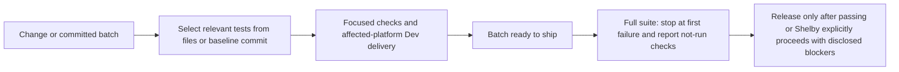

<!-- faster-verification-2026-11-06 -->
# Focused verification during development, broad checks at release

Routine changes currently repeat expensive broad-suite work and encounter unrelated baseline failures. The test selector already finds relevant tests, but after committing and pushing on main its default origin/main comparison has no delta. Add an explicit historical baseline and a fail-fast option, then make focused checks the routine Dev gate and the full suite a batch/release gate.

Shelby requested the next faster-development/deployment step after direct phone delivery was completed. The previous proposed next step was focused tests per change and broad checks per release. This request authorizes that workflow update; no new application installation or external scheduling is required.

## Scope and acceptance

- [x] V1 Add `--since REV` to scripts/tests-for.sh. Acceptance: committed parent and Core changes, dirty/new files and structural checks are selected even on clean pushed main; invalid revisions or unavailable Core history fail clearly. Existing file/default selection remains compatible.
- [x] V2 Add `--fail-fast` for runs. Acceptance: stop after first failing script, return failure, preserve its log and explicitly count unrun scripts; default mode still continues. Isolated fixture tests prove execution order, return codes and no false green.
- [x] V3 Update AGENTS.md and runner help for focused Dev checks versus full batch/release checks. Acceptance: required relevant tests remain; no repeated full suite for every edit/Dev install; known blockers disclosed and no scheduled task created. Run selector/runner regressions, commit and push tooling. No app/phone build or service restart.

Deliverables: runner, isolated Git/submodule/runner fixtures, policy and this tracked plan committed/pushed. Existing mobile logic/snapshot test migration in plans/fast-phone-tests.md remains a separate larger follow-up. Removing duplicate Mac build/install work is also separate; no hidden implementation expansion.

Verification: scripts/test-tests-for.sh (existing mappings plus new fixture checks); shell syntax and scripts/tests-for.sh --why --since against a real earlier parent commit. Tests use temporary repos and tiny stand-in scripts, never paid models, live chats or real builds. No broad native run for this routine tooling change under the newly authorized focused workflow; broad validation remains required for a release batch. Rollback: revert scoped tooling/policy commits; no app data/schema/configuration migration. Preserve uncommitted/concurrent work; do not alter the known failing transition test or suppress failures.

Work preparation: confirmed scope/now from Shelby's direct next-step request. Mode: linear because policy, selector and its fixtures are one small dependency chain. Model: current session, exact model/effort unavailable. Readiness: pass R1–R13; flow above covers R3; no UI or installation change. Open questions: none. Tracking: https://github.com/shelbyklein/chatterbox/issues/56

Validation: scripts/test-tests-for.sh passes all existing mapping checks plus ten hermetic Git/runner scenarios (the new fixture set took 8.7s). Coverage includes clean committed-and-pushed parent/Core deltas, staging/untracked/Unicode paths, renames, a newly added Core checkout, unavailable history/checkout, invalid flags, early failure/log preservation, default continuation and empty/successful runs. scripts/check-sources.sh, shell syntax and diff checks pass. Live `--why --since 16875ee` selects only check-sources and test-tests-for for this tooling change, and the earlier 526fa2d baseline correctly includes the committed Activity UI changes. No native builds or agents ran.

Delivery: tooling/policy only, so delivery is commit/push on main; no Dev app rebuild, phone install, service restart, TestFlight or scheduled task. This implements Shelby's requested next step: focused checks for routine Dev work, full suite once for a release batch, with failure/unrun coverage disclosed. The known application-suite blockers are unchanged and not claimed resolved. Issue remains open for user review/acceptance.
