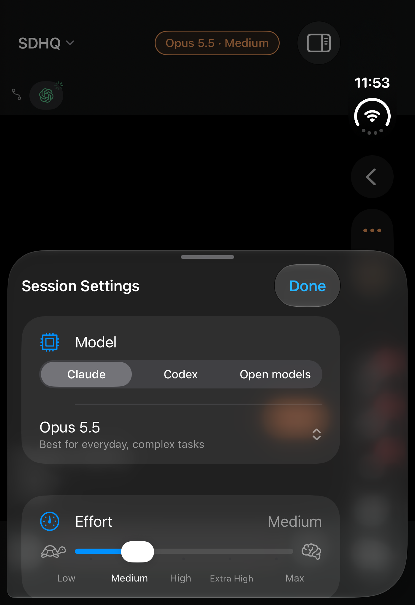
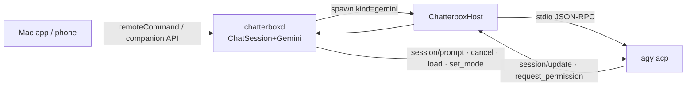

# Gemini as a third agent (via Antigravity CLI)

Issue: https://github.com/shelbyklein/chatterbox/issues/71

## Summary

Chatterbox runs two agents today, Claude Code and Codex. This plan adds **Gemini** as a third agent with the same reach: Mac chats, the phone, sidequests and work threads, automations and the Desk. It runs Google's **Antigravity CLI** (`agy`), signed in with Shelby's Google AI Ultra account and driven over the Agent Client Protocol (`agy acp`). Open models (the PC's models) leave the pickers for now.

## Problem

- **Missing today:** Gemini can't be used in Chatterbox at all. `Backend` has only `claude` and `codex` (`Core/Shared/Backend.swift:4-15`). About 46 files special-case those two, and many places assume there are exactly two agents (`backend == .codex ? A : B`). Examples: `Models.swift:259`, `ChatSession.swift:491,519`, `PermissionModes.swift:32`, `Usage.swift:96`, `ModelPicker.swift:97`, `ChatSettingsSheet.swift:133,213`, `MobileSidequests.swift:8-83`, and `bin/work:170` (`--agent choices=["claude","codex"]`).
- **The old Gemini CLI is the wrong tool.** The installed `gemini` (0.1.12, `/usr/local/bin/gemini`) can't serve personal accounts. Since June 18, 2026, Google AI Pro/Ultra and free accounts go through Antigravity CLI ([Google announcement](https://developers.googleblog.com/an-important-update-transitioning-gemini-cli-to-antigravity-cli/), [discussion](https://github.com/google-gemini/gemini-cli/discussions/27274)). `agy` isn't installed. Only the Antigravity app 2.9.1 and its `~/.gemini/antigravity/bin/agentapi` are present.
- **Open models are offered and Shelby doesn't want them for now.** They show on the Mac picker (`ModelPicker.swift:123`), the Mac Desk (`DeskView.swift:1579`) and the phone (`ChatSettingsSheet.swift:144`). The gate is `PCModels.enabled`, which defaults to on (`RemoteMachine.swift:188`).
- **Who it affects:** Shelby, on the Mac and the phone.

Current picker (phone):



## Target

The provider switch gains Gemini, and Open models leave it:

```
┌ Model ────────────────────────────────┐
│ [ Claude ][ Codex ][ Gemini ]         │
│ Gemini 3 Pro                        ⌃⌄│
│ Google's most capable model           │
└───────────────────────────────────────┘
┌ Permissions            Ask before edits┐
│  (✋)  (✎)  (⚡)                        │   ← Gemini's own modes from `agy acp`
└───────────────────────────────────────┘
```

Gemini gets its own agent mark and color everywhere Claude and Codex have one: chat list, header pill, sidequest icons, Desk, automations and the widget shortcut.

Flow (same shape as Codex: the service drives the agent, and the host keeps the process alive):



## Decisions (settled)

- **Full agent,** like Codex: project folders, file edits, permission modes, resumable sessions, and the model picker on Mac and phone (Shelby, 2026-11-20).
- **Sign-in is Shelby's Google account (AI Ultra) through `agy`.** No API key.
- **First version reaches** Mac chats, the phone, sidequests and work threads, and automations and the Desk.
- **Open models are hidden for now, not removed.** The code stays, and chats already on an open model keep working.
- **Uses Antigravity CLI `agy acp`, not Gemini CLI.** It's shown as "Gemini" in Chatterbox.
- **Sidequests with three agents:** `sidequest` keeps Claude↔Codex as its default "other agent" and gains `--agent gemini|claude|codex`. `work start --agent` gains `gemini`.

## Success criteria

1. **A Gemini chat works end to end on the Mac.** Start one in a project folder, ask for a file edit, approve it, and see the reply stream with tool rows. Quit and reopen the app, and the chat resumes its session. *Verified on the installed app, Chatterbox Dev first, then the real app.*
2. **The phone shows Gemini** in Session Settings and New Chat, with its icon and color, and a Gemini chat can be read and sent to. *Verified on Shelby's Duo after the install, and by the HomeNav picker test.*
3. **`sidequest --agent gemini`, `work start --agent gemini`, a Gemini automation and a Gemini Desk start each run.** *Verified by the engine tests (sidequest, work-threads, automation-routines, desk) using a fake `agy`, plus one live sidequest.*
4. **Open models no longer appear** on the Mac picker, Mac Desk or phone, and an existing open-model chat still opens and sends. *Verified by the model-selection test and a phone screenshot.*
5. **Claude and Codex behave exactly as before.** *Verified by the focused tests from `tests-for.sh` on the changed files, all passing.*

## Deliverables

- **Code:** `Backend.gemini`; `GeminiSettings` on the record; the ACP client (`Core/Chatterbox/Engine/GeminiACP.swift`) and `ChatSession+Gemini.swift`; a Gemini model catalog and permission modes; host `kind=gemini` parsing; Mac and phone UI; `bin/work` and `bin/sidequest`; the Open models gate. *Committed and pushed to main (Core first, then the parent gitlink).*
- **Assets:** an `AgentGemini` mark in both asset catalogs. *Committed.*
- **Project files:** `xcodegen generate`, plus `project.yml` and `scripts/runtime-sources.sh` listing the new files. *Committed.*
- **Tests:** a new `tests/gemini-agent` with `scripts/test-gemini-agent.sh` and a fake `agy acp` added to `tests/fixtures/fake-provider.py`. *Committed, passing.*
- **Changelog:** a line per user-visible change in `Core/Shared/Changelog.swift`. *Committed.*
- **Install:** Chatterbox Dev on the Mac and the phone first (this touches saved chat records and the phone protocol). *Installed in Dev, then installed for real once Shelby taps **Ship**.*
- **`agy`:** installed on the Mac with Google's install script and signed in by Shelby. *Installed; sign-in is Shelby's step.*

## Tasks

| ID | Task | Acceptance check |
|---|---|---|
| T1 | **Install and probe `agy`.** Install Antigravity CLI (`curl -fsSL https://antigravity.google/cli/install.sh \| bash`). **Gate: Shelby signs in** (`agy acp --login` or `agy` login). Script one ACP session that runs `initialize`, `session/new`, a prompt that edits a file, a permission request, `session/cancel`, `session/load`, `session/set_mode`, a model change and an image prompt. Record the capabilities, mode IDs, model IDs and whether `usage_update` arrives. Also decide one `agy acp` process per chat (like Claude) or one shared process (like Codex). | `plans/assets/gemini-agent/acp-probe.log` holds the transcript, and this plan's **Protocol notes** section lists the real mode IDs, model IDs and capabilities. |
| T2 | **Model the agent.** Add `Backend.gemini`, with its label, icon and color; `GeminiSettings` (folder, model, mode, sessionId, host) on `ConversationRecord`, optional so old records decode; and fix `record.backend` derivation (`Models.swift:259`). Turn the two-agent ternaries into `Backend` properties. | New test `tests/gemini-agent`: old Claude, Codex and open-model records decode unchanged and keep their backend; a Gemini record round-trips. |
| T3 | **Build the ACP client** (`GeminiACP.swift`). Spawn `agy acp` through `HostClient` with `kind: "gemini"`. Handle JSON-RPC requests, notifications and server requests. Locate the binary (preference `agyPath`). Add host `Child.swift` parsing so busy and waiting-on-you states show. Add the files to `project.yml` and `runtime-sources.sh`. | The test spawns the fake `agy acp` through the host, and initialize, a prompt and a cancel complete. Host busy and waiting states flip in `test-host-handoff.sh`-style checks. |
| T4 | **Build `ChatSession+Gemini`.** Send, streaming (`agent_message_chunk`, `agent_thought_chunk`, `tool_call`/`tool_call_update` mapped to tool rows with diffs, `plan`), permission requests mapped to the existing approval UI, interrupt (`session/cancel`), restart, resume (`session/load` after a relaunch, with the host reattaching), images as content blocks, and AGENTS.md / instructions as context. Wire every `switch record.backend` in `ChatSession.swift`. | With the fake `agy`: a reply streams, a tool row with a diff shows, an approval round-trips allow and deny, interrupt ends the turn as cancelled, and a reattach after a service restart resumes the same `sessionId`. |
| T5 | **Add models, modes and usage.** A Gemini model catalog from ACP (or the T1 list), Gemini permission modes in `PermissionModes`, context fill from `usage_update` if sent, and no account limit meter (it isn't exposed). | Unit checks in `tests/gemini-agent`: the catalog names, mode mapping to `session/set_mode`, and the context value. The model-selection test passes with a Gemini case. |
| T6 | **Mac UI.** A Gemini segment in `ModelPicker`, `AgentSwitch` (all cases), a New Gemini Chat menu item, a Settings pane (agy path, sign-in status, default model and mode), and the icon and color everywhere (chat list, toolbar, sidequest, Desk, automations, usage). | A Mac UI test or screenshot shows the Gemini picker and a Gemini chat's toolbar. `tests/model-popover` passes. |
| T7 | **Phone.** `ChatOptions.geminiModels`, the provider switch tab, the agent icon and color (`MobileAppearance`, `MobileConversationStyle`), string compares for `"gemini"`, the widget mark, and Companion `apply()` for a backend switch to Gemini. | A HomeNav test (`MOBILE_TEST_ONLY` on the picker tests): the Gemini tab lists its models, and picking one switches the chat's agent. Check the screenshot. |
| T8 | **Sidequests, work threads, automations and the Desk.** `bin/sidequest --agent`, `bin/work --agent gemini`, the automation agent picker, and a Desk start or retry on Gemini. Prompts get Gemini's context file name. | `scripts/test-sidequest.sh`, `test-work-threads.sh`, `test-automation-routines.sh` and `test-desk.sh` pass with new Gemini cases. |
| T9 | **Hide Open models.** Default `PCModels.enabled` to false in both places, drop the "already on an open model" picker clause, and hide the Settings toggle. Existing open-model chats keep running. | The model-selection test: no open models in options, and an existing open-model chat still sends. The phone screenshot shows no Open models tab. |
| T10 | **Verify and install to Dev.** Run `scripts/tests-for.sh --run --fail-fast --since <base>`, then `scripts/install-dev.sh` and `scripts/install-phone.sh --dev "Shelby's Duo"`, then a live Gemini chat in Dev. | All focused tests pass (counts recorded). A live Dev Gemini chat edits a file with approval and resumes after a Dev service restart. |
| T11 | **Ship. Gate: Shelby taps Ship.** Changelog lines, `scripts/install.sh`, `scripts/restart-service.sh` (idle wait), `scripts/install-phone.sh "Shelby's Duo"`. | The real app and service are healthy (`service-restart.txt` OK), and the Duo has the build. Report installed, not just built. |

## Exclusions and what must not change

- **No API-key or Vertex sign-in, and no Gemini CLI (`gemini`) support.** The old `/usr/local/bin/gemini` is left alone.
- **Gemini isn't run on the PC.** Remote and PC routing for Gemini is out of scope.
- **No account usage-limit meter for Gemini.** Not exposed; context fill only if ACP reports it.
- **Claude and Codex keep** their behavior, records, settings, defaults and sidequest default pairing.
- **Open model code, records and service paths stay.** Only the pickers hide them.
- **The iPad isn't touched.**

## Test plan

- **New:** `scripts/test-gemini-agent.sh` (`tests/gemini-agent/main.swift`) with the fake `agy acp` in `tests/fixtures/fake-provider.py`: record decoding, streaming, tools, approvals, cancel, resume and modes.
- **Existing, extended:** `scripts/test-model-selection.sh`, `test-sidequest.sh`, `test-work-threads.sh`, `test-automation-routines.sh`, `test-desk.sh`, `test-host-handoff.sh`, `test-current-model.sh`.
- **Picked by the selector:** `scripts/tests-for.sh --run --fail-fast --since <base>` for everything else the changed files touch. Add `scripts/test-map.txt` lines for the new files.
- **Phone UI:** `MOBILE_TEST_ONLY="HomeNavTests/HomeNavTests/testNewChatPicksSettingsFirst,HomeNavTests/HomeNavTests/testEdgeSwipeAndCards" scripts/test-mobile-home-nav.sh duo`. The real entry point is Session Settings from the header pill, and New Chat. Check the rendered screenshot of the provider tab.
- **Live:** in Chatterbox Dev, one real `agy` Gemini chat in a scratch folder that edits a file with approval, then resumes after a Dev service restart.

## Rollback

- **Mac app:** the real install keeps the previous app (`scripts/rollback.sh`), and Dev is tried first.
- **Saved data:** `GeminiSettings` is a new optional field. Older builds ignore it, so rolling back leaves Gemini chats unreadable as Gemini but doesn't break other chats. Before the first real install, back up `~/Library/Application Support/Chatterbox` chat records (`Conversations/`).
- **Phone:** reinstall the previous build from `build/DerivedDataMobile` history, or roll forward.
- **`agy`:** remove its install directory and `~/.gemini/antigravity-cli/` to uninstall.
- **Open models:** turn the preference back on (`openModelsEnabled = true`).

## Open questions (none blocking)

- **The exact mode IDs and model IDs `agy acp` exposes, and whether it sends `usage_update` or supports images.** T1 answers these. The plan adapts names, not structure.
- **One process per chat or shared.** T1 decides from `agy acp`'s session handling.

## Protocol notes (T1, 2026-11-20)

`agy` 1.5.13 is installed at `~/.local/bin/agy` and already signed in. It listed the account's models with no login step. The probe scripts and transcripts are `assets/gemini-agent/probe*.py` and `acp-probe*.log`.

- **Start:** `agy acp` (stdio JSON-RPC, ACP protocol version 1). `initialize` returns:
  - `loadSession: true`;
  - prompt capabilities: `image: true`, `embeddedContext: true`;
  - `sessionCapabilities`: `resume`, `close`, `load`, `list`, `additionalDirectories`;
  - `_meta.antigravity.systemPrompt.append: true`;
  - auth methods `oauth-personal` (used), `oauth-business`, `gemini-api-key`, `agent-platform`.
- **New session:** `session/new {cwd, mcpServers}` returns `sessionId`, plus:
  - `models` (ids carry effort: `gemini-4-neon-high` and so on);
  - `modes`;
  - `configOptions`, three of them:
    - `model`: `gemini-4-neon` (default), `gemini-4-carbon`, `gemini-4-argon`, `gemini-4-hydrogen`, three Orchestrators, `gemini-3.8-flash`, `claude-opus-5-5`, `claude-sonnet-5-5`, `gpt-oss-120b-medium`;
    - `thought_level`: `low`, `medium`, `high` (default), `xhigh`;
    - `mode`: `default`, `accept-edits`, `auto`, `plan`.
- **Changing settings:** `session/set_config_option {sessionId, configId, value}` for the model and `thought_level`, and `session/set_mode {sessionId, modeId}`. Each echoes `config_option_update` / `current_mode_update`.
- **Mode meanings** (from agy): `default` asks before edits and commands; `accept-edits` approves workspace edits; `auto` approves edits and safe commands and asks before irreversible actions; `plan` plans before executing. `--dangerously-skip-permissions` approves everything (a bypass flag, only at launch).
- **Updates (`session/update`):**
  - `agent_message_chunk` and `agent_thought_chunk` carry `{content:{type:text,text}}`;
  - `tool_call` and `tool_call_update` carry `toolCallId`, `name`, `args`/`rawInput`, `status`, `kind`, `title`, `locations`;
  - `usage_update {used, size}` gives context fill (size 1,048,576);
  - also `session_info_update {title}`, `available_commands_update`, `config_option_update`, `current_mode_update`.
- **Permissions:** a `session/request_permission` request whose `toolCall` includes `content:[{type:diff,path,newText}]`. The options are `allow` (`allow_once`) and `deny` (`reject_once`). Reply `{outcome:{outcome:"selected",optionId}}`.
- **Prompt result:** `{stopReason, usage:{inputTokens,outputTokens,cachedReadTokens,thoughtTokens,totalTokens}}`.
- **Cancel:** the `session/cancel` notification returns `stopReason: cancelled`.
- **Images:** `{type:image, mimeType, data(base64)}` works.
- **Resume:** `session/load` in a new process took 1.1 s, replayed the old turn (6 updates) and kept the memory. `session/resume` (advertised) resumes without a replay; use it, and fall back to `load` and ignore updates until the reply.
- **Decision: one `agy acp` process per chat,** hosted like Claude's (`kind: "gemini"`). Each chat holds its own `sessionId`, and resuming is fast and cheap.
- **Effort:** use `thought_level`, named with the existing effort names (Low/Medium/High/Extra High).
- **Model list:** take it from `configOptions.model`. Chatterbox shows the Gemini and Orchestrator entries; the Claude and GPT entries through agy are hidden, since Claude and Codex have their own agents.
- **Usage:** context fill from `usage_update`; no account limits are exposed.

## Work preparation

- **Confirmed scope:** Shelby, 2026-11-20. Full agent; Google account (AI Ultra) via Antigravity CLI; Mac, phone, sidequests and work threads, automations and the Desk; hide Open models for now.
- **Plan:** this file.
- **Mode:** `linear`. The tasks share core files (`ChatSession.swift`, `Models.swift`, the picker views) and depend on T1's protocol findings, so parallel lanes would collide.
- **Models:** the current session (Claude Opus 5.5, `claude-opus-5-5`); exact effort not exposed.
- **Gates:** T1 sign-in (Shelby); T11 Ship (Shelby). Dev install (T10) is covered by the standing delivery approval.
- **Readiness:** pass · 2026-11-20 · R1–R11, R13 pass · R12 pass (Dev first, rollback.sh, optional record field, open-models pref) · R3 pass (current screenshot, target sketch, flow diagram).
- **Now or later:** not yet decided.
