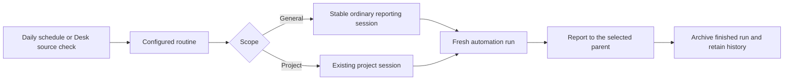

# General automations and independent morning priorities

The ClickUp + Outlook morning-priorities routine is currently owned by the On Target development project. Shelby asked on November 6, 2026 for it to be general, because that project is for developing On Target rather than using the daily review. Add first-class general automations and move this routine to its own non-project reporting session while retaining existing project automations.

## Current behavior and evidence

- Real configuration: `~/Library/Application Support/Chatterbox/Automations.json` contains seven enabled entries titled `ClickUp + Outlook morning priorities`, one per weekday at 08:30, all with `projectFolder=/Users/shelbyklein/Vibes/On Target`. Their prompts explicitly route results to the On Target parent session.
- `Core/Chatterbox/Engine/ProjectAutomations.swift`: `ProjectAutomation.projectFolder` is a required String, and routine grouping includes that folder. Removing the property would make decoding fail; an empty value is not a supported general target.
- `ChatterboxDaemon/AutomationRunner.swift`: each run requires a matching open project session and fails otherwise. `Core/Chatterbox/Engine/ChatSession+Sidequest.swift` creates a run as a sidequest reporting to that project.
- `Core/Chatterbox/Views/AutomationsSheet.swift`: the app-wide Automations panel groups by project and its Add Automation menu requires a project. Companion mapping/API also assume a project label/folder.
- Existing editor screenshot: [project editor](../design/ux-panel/screens-r2/26-mac-automation-editor.png). This is a recorded UI proof, not a live screenshot from this investigation; inspected source confirms the project-only restriction still exists.
- Baseline inspected: parent `d2a77a7804f0461749c8b776ce52d8656cd9400c`, Core `dcc7bf0b0cf1186795a00ab0057c3bcdd3b6febb`. Concurrent unfinished Desk work changes Core's `ProjectAutomations.swift` and `DeskStore.swift`, parent tests and `bin/desk`; preserve it and reconcile its owner before integration. Related work: [Desk import deduplication #50](https://github.com/shelbyklein/chatterbox/issues/50).

## Confirmed outcome and boundaries

General is a real scope with no project folder, not a dummy project or a link to the Chatterbox development repository. Each general routine reports to a stable, dedicated ordinary session; this routine's session is named Morning priorities. Use the normal general-session working directory and general tool configuration; never inherit On Target's repository instructions, transcript, or development context. Preserve the routine's explicit Codex agent configuration.

Keep the daily 08:30 America/New_York schedule, enabled flags, weekday-entry IDs, created dates, latest-run state/history, source account boundaries, read-only review behavior, authorized Desk placement, and report path under the USA Archery Studio. Replace only the prompt's On Target delivery wording. This request does not authorize broadening data access or actually running today's review.

## Target UI and flow

The existing app-wide Automations entry shows a General group in addition to its project groups. Add Automation offers General or a named project; the editor exposes this scope clearly. General routine details on Mac and phone say General and expose the reporting session; On Target's project list no longer contains the migrated routine. Retain existing project creation, editing, schedules, and reporting behavior.

Target sketch: [general automation scope](assets/general-automations/target.svg).

## Success criteria

1. General routine save/load, schedule execution, manual Run Now and Desk source checking work without any open project; behavioral fixture tests prove the run and result target have no project and no On Target context.
2. Dev's migrated morning-priorities routine appears under General on Mac and phone, has one dedicated reporting session, retains all seven IDs and the 08:30 schedule, and no longer appears under On Target. Verify saved config, companion readback and rendered UI.
3. Existing project routines decode and report unchanged. Repeated migration, repeated run requests, archived/missing general reporting sessions, and an active previous run do not create duplicates or redirect work to an unrelated chat; fixture tests prove these cases.
4. Real app/configuration remain intact through Dev delivery. Apply the backed-up real-data migration only after Shelby says ship; then verify persisted and service-visible scope without triggering a paid/source-review run.

## Deliverables

- Parent and Core commits pushed with scoped model, runtime, API/UI, fixture tests and docs; preserve unrelated concurrent changes.
- A reviewed, idempotent migration tool for this named existing routine, with dry-run and exact before/after verification; no replacement scheduler or duplicate automation.
- Chatterbox Dev built/installed with general-automation fixture proof and screenshots; real installation/migration awaiting Ship.
- Tracking issue with this checklist and validation/delivery evidence; no implementation boxes checked during planning.

## Dependency-ordered tasks

| ID | Task | Acceptance |
|---|---|---|
| T1 | Add backward-compatible explicit General/Project scope and stable general reporting-session identity. Update grouping, persistence and companion mapping. | Old project fixtures decode identically; general fixture round-trips without projectFolder; sibling weekday entries remain one routine. Reject conflicting target data rather than guessing. |
| T2 | Resolve general reporting sessions through the runtime and start fresh independent runs; preserve project runs and Desk integration. | Stand-in runner proves general scheduled/manual/Desk runs report only to their dedicated session, no On Target context; running guards and session recovery avoid duplicates. No live connector/model invocation in tests. |
| T3 | Update existing Mac Automations panel/editor and phone routine list/detail for General scope. | Real entry point Automations > General and Add Automation > General works; rendered Mac and focused phone proofs show scope, reporting session and preserved project routines. Empty general state works with no open project. |
| T4 | Prepare and dry-run the exact seven-entry migration, then apply it to Dev fixture data. | Before/after structural diff allows only scope/destination fields and the delivery sentence; all IDs/schedules/settings/state/history/reports remain preserved. Second application is a no-op; target mismatch fails closed. |
| T5 | Run relevant tests, then the full suite once; commit/push scoped changes and install Dev. | Record test results and actual Dev install/service state; inspect persisted Dev scope and rendered UI. Disclose failures rather than claiming uniform coverage. Offer Ship; do not touch real app/data. |
| T6 | After Shelby says Ship, ship the verified code and apply the backed-up real routine migration. | Reconcile latest config before writing, preserve all unrelated routines and latest run state, verify all seven entries and companion/installed UI readback. Do not trigger a review. Record live migration evidence and close tracking only when complete. |

## Tests and delivery

Run `scripts/tests-for.sh --why` and `scripts/tests-for.sh --run` against the actual scoped changes. Expected coverage includes `scripts/test-automation-routines.sh`, `scripts/test-sidequest.sh`, `scripts/test-automations-panel.sh`, `scripts/test-flavor.sh`, and focused relevant phone Automations tests through `scripts/test-mobile-home-nav.sh`; confirm exact selectors from the current script before running. Add meaningful scope/session-recovery/migration tests to the existing suites and map new coverage if needed. Before completion run `scripts/tests-for.sh --run --all` once, reporting any failures.

Use existing build locks, allowed build folders and test hygiene. Install with `scripts/install-dev.sh`, with a heads-up and normal idle-safe restart behavior. No direct real-service stop, blind host kill, `--now` interruption, external-source writes, mail changes or live review run. Real delivery uses existing ship workflow only after Ship authorization.

## Rollback

Before any config migration, create timestamped backups of Automations.json and automation-state.json plus only any reporting-session records the migration modifies; don't overwrite reports or old runs. Compare source hashes/revisions immediately before the atomic migration and stop if they changed. Preserve IDs and state to avoid replaying missed schedules. Recovery reverts the scoped code and restores only the migrated routine/destination fields from backup against current data, preserving concurrent unrelated edits. A schema downgrade must restore project-scoped config before running old code, or general rows may fail old decoding. Do not broadly restore all conversation data or delete historical runs.

## Open questions

No blocking product questions. The requested general scope is clear; the proposed dedicated Morning priorities session is a reversible destination choice. Implementation authorized November 6. Real shipment remains a separate Ship gate.

## Work preparation

- Scope: Shelby's November 6 instruction to make the On Target usage automation general, independent of its development project; source/account limits and schedule retained.
- Tracking: https://github.com/shelbyklein/chatterbox/issues/51. Local plan: `plans/general-automations.md`.
- Mode: linear. One executor owns the cross-cutting schema/runtime/UI/migration sequence; parallel edits would overlap existing Desk work.
- Model/effort: current Codex session; exact model/effort unavailable. No delegated agents or handoff.
- Now/later: now, explicitly authorized November 6, 2026. Linear implementation uses isolated worktree `/Users/shelbyklein/Vibes/Chatterbox-general-automations` (parent and Core branches `general-automations`). T1/T2/T3/T4 complete; T5 in progress; real configuration unchanged.
- Readiness: R1-R13 pass on November 6, 2026. R3 has recorded current-editor proof, target SVG and flow diagram; R12 includes backed-up, narrow and idempotent migration/rollback. Tracking issue created and read back; checklist aligned. This is planning readiness, not implementation completion.

## Implementation checklist

- [x] T1: Scope model, persistence and companion mapping.
- [x] T2: General runtime target, fresh runs and Desk integration.
- [x] T3: Mac and phone scope UI and rendered proofs.
- [x] T4: Exact routine migration and Dev fixture verification.
- [ ] T5: Validation, scoped commits/push and Dev delivery.
- [ ] T6: Ship gate, real migration and installed verification.

## Compatibility detail

Stored General routines have no projectFolder. The companion wire response retains its legacy required projectFolder string as empty for General, with project label General and additive reporting-session fields, so older phone clients can still list and run the routine. No dummy project or folder is created.

## Implementation evidence

- T1/T2: `scripts/test-automation-routines.sh` passed 86 behavioral checks, including General persistence, dedicated session preparation with no agent, archived-session recovery, rejection of project-promoted reporting targets, independent scheduled runs with the former project closed, cross-weekday overlap guards and Desk-source integration. No model or external-source request ran.
- Migration unit tests: three tests pass, checking exact allowed deltas, mismatched-target refusal, dry-run purity, backup contents and repeat-application idempotence. Dev migration pending.

- Source checkpoint: Core `dee99ed`, parent `0962c2f`, pushed on `general-automations`. Review drafts: [Core #23](https://github.com/shelbyklein/chatterbox-core/pull/23), [Mac/runtime #53](https://github.com/shelbyklein/chatterbox/pull/53).
- Native Mac rendering passed; inspected proofs in `design/general-automations/mac-center.png` and `mac-editor.png`. The paused General fixture is one daily routine despite seven weekday entries. Phone compile passed; UI rerun waits for the shared simulator after correcting its legacy-response fixture.
- Exact current real configuration copied into an isolated build fixture and migrated twice: the first run changed only the seven destination fields/delivery wording; the second was a no-op. Unrelated routines and run-state bytes were preserved. Real configuration has not been changed.
- Full regression command `scripts/tests-for.sh --run --all` started; results in `build/general-full-suite.log` and `build/test-logs/`. Final coverage and Dev installation are pending.

- Focused phone verification on iPhone 17 Pro / iOS 26.2: `testAutomationsFromMenu` and `testGeneralAutomationReportingSession` passed (16.7s/12.0s), then `testAutomationEditAndRunFromDesk` passed (24.3s) after revealing its run button following keyboard scrolling. Inspected `phone-detail.png` and `phone-report-session.png` in `design/general-automations/`. No external source or paid agent was invoked.
- Final automation-routines run: 88 checks pass, including General presets and unset-agent defaults agreeing between companion display and the actual prepared runtime parent. Four migration tests pass, including explicit real/Dev-write guards.

- Installed Mac Dev from this branch on November 6; Dev service restarted safely with rule idle at 15:41:19 and reported healthy after 5s at 15:41:27. The subsequent upstream merge adds only the already-completed mobile Activity change and its test/proof files; Mac implementation is unchanged.
- Dev preview imported seven paused weekdays with fixture-only instructions (no external source reads), then applied the migration online twice. The second run was a configuration no-op. Runtime preparation created the ordinary Morning priorities chat with Codex, the Dev data working directory, no project/Studio/parent context, no items or agent host. Exact preview IDs, 08:30 schedule, unrelated Dev routines and run-state bytes were verified. Real Automations.json bytes remain unchanged.
- Installed UI acceptance through CUA: toolbar Automations → General card (one daily routine) → Open Session (ordinary Chats destination); Add Automation → General → Edit shows Scope General and Reports to Morning priorities. No Run Now action or source review was started. Inspected/saved installed captures: `dev-installed-center.png`, `dev-installed-editor.png`, and `dev-installed-report-session.png` under `design/general-automations/`. State proof: `dev-preview-state.json`.

## Current delivery status

Implementation, focused validation and installed Dev preview are complete. T5 remains unchecked because broad validation is incomplete: the full-suite attempt produced 12 passing scripts and one unchanged chat-transition policy failure, then was stopped safely; 98 scripts were not completed. Detailed evidence and the deterministic old-test/current-behavior mismatch are in `design/general-automations/validation.md`. No related source defect was observed in the General automation checks.

T6 remains gated on Shelby saying Ship. The real routine still belongs to On Target until that step. The Dev fixture is intentionally paused and source-free; it is not a live morning review. The feature branches and installed proof are ready for review; the issue and PR drafts remain open.

Final Dev restoration: combined branch includes both completed Activity commits and the connection-error correction. A concurrent installation temporarily replaced Dev; restored build/service healthy at 16:10:02, General capability and native card reverified, with the same seven paused preview IDs and reporting session. Real configuration unchanged. Current proof: `design/general-automations/dev-restored-center.png`. Mapping regression passes. T5 broad-coverage limit and T6 Ship gate remain explicitly open.
