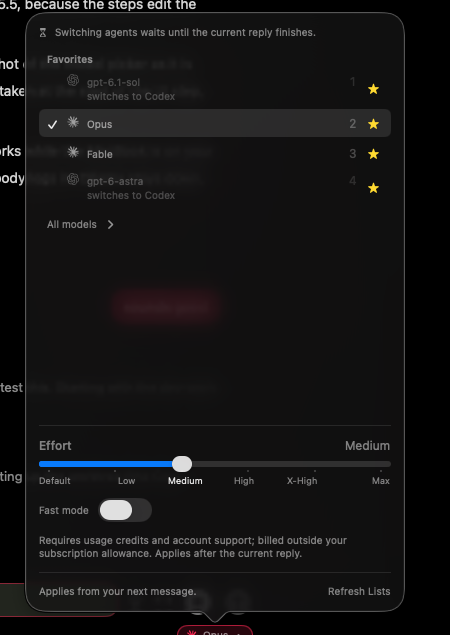

<!-- pc-worker-2026-10-22 -->
# Shelby-PC as a Chatterbox worker (Claude, Codex, open-weight models)

Issue: https://github.com/shelbyklein/chatterbox/issues/48 · Branch/worktree: `virtual-desktop`

## Summary
Shelby's idle Windows PC (Shelby-PC) should do agent work for Chatterbox, so the Mac doesn't have to. A chat can be set to **Run on: Shelby-PC**. Its Claude or Codex agent then runs on the PC over SSH, in a scratch workspace there, and files it makes are copied back so they show in the chat. Any chat, on the Mac or the PC, can also pick an **open-weight model** served by Ollama on the PC's RTX 3080 Ti.

## Problem
**Current behavior**
- Every agent process runs on the Mac. Chats go `chatterboxd` → `ChatSession` → `HostClient.spawn(executable:arguments:cwd:environment:)` (`Core/Chatterbox/Engine/HostClient.swift:171`) → `ChatterboxHost` `posix_spawn` with a local `chdir` (`ChatterboxHost/Child.swift:98-111`). Nothing can run elsewhere.
- Claude runs one process per chat (`ClaudeCodeProcess.arguments`/`start`, `ClaudeCode.swift:93-119`). Codex runs one shared `codex app-server` for all chats, a singleton with `cwd: nil` (`CodexAppServer.swift:81-105`).
- Binary lookup checks the local disk (`BinaryLocator.find`, `ClaudeCode.swift:10-36`; `CodexAppServer.locateBinary`, `:206`).
- Chats can't pick an open-weight model. Custom endpoints exist only for EasyCLIProxy (Claude `ANTHROPIC_BASE_URL`, `ChatSession+Claude.swift:629`; Codex `model_providers.easycliproxy`, `EasyCLIProxy.swift:106`). Model lists come only from Claude's `initialize` probe and Codex's `model/list` (`ClaudeModels.swift:55`, `CodexAppServer.swift:329`).
- The earlier Docker "agent computer" ran on the Mac. Shelby removed it because they don't want it on the Mac (`plans/remove-agent-computer.md`).

**Who it affects:** Shelby. Long or messy jobs (installs, downloads, experiments) load the Mac, and the PC's 32 GB of RAM and 12 GB GPU sit idle.

**PC as found (2026-10-22)**
- Hardware: Windows 10 Home 19045, Ryzen 7 1800X, 32 GB RAM, RTX 3080 Ti 12 GB (driver 610.88). Disks are healthy: C: 351 GB free, D: 505 GB free (SSD), F: 1.3 TB free (HDD).
- Access: `ssh desktop` works (user `sklei`, admin, PowerShell default shell, `sshd` Automatic). No Tailscale. PIA VPN adapter active.
- Agents: Claude Code 2.1.263 and Codex 0.146.0 are installed and both signed in. Node, git and Docker Desktop are installed.
- Ollama 0.32.6 has models `gpt-oss:20b`, `gpt-oss-pc:20b`, `gemma4:12b`, `gemma4-codex`, `qwen3.5:9b` (26 GB), but it isn't running. Starting it from SSH fails ("Unable to init instance") because SSH runs in session 0. The desktop session is session 1 (explorer, Sunshine).
- Sleep is off on AC. Auto-logon is off.

**Desired behavior:** see Success criteria.

## Target flow
Mermaid source: [`plans/assets/pc-worker/flow.mmd`](assets/pc-worker/flow.mmd)

- **Launch.** The host spawns `ssh -T desktop node <worker>` instead of the provider. The worker reads one JSON header line (argv, env, cwd, secrets), launches `claude.exe` or `codex.exe` with clean byte-for-byte stdio, and kills the whole process tree (`taskkill /T`) when stdin closes. Secrets therefore travel over the SSH channel, not on a command line.
- **Workspace.** Each PC chat works in `D:\Chatterbox\workspaces\<chat-slug>`.
- **Files back to the Mac.** After each turn, the daemon pulls files changed in that turn (up to 200 MB) into `~/Chatterbox/PC/<chat-slug>/`. PC paths in replies map to that mirror, so previews and "show file" keep working.
- **Attachments to the PC.** Attachments are uploaded to `D:\Chatterbox\attachments\` before a turn when needed (Codex `localImage`, non-image files).
- **Ollama.** It starts at Windows logon with a long context (`OLLAMA_CONTEXT_LENGTH=32768`) and listens on PC localhost only. PC chats use `localhost:11434`. Mac chats reach it through a daemon-managed SSH tunnel at `127.0.0.1:47340`.

### UI sketch (model popover, new sections)
```
┌ Model ───────────────────────────┐
│ Favorites …                      │
│ Claude …   Codex …               │
│ PC models (Ollama on Shelby-PC)  │
│   gpt-oss:20b · gemma4:12b · …   │
│ ──────────────────────────────── │
│ Connection  [Direct ▾]           │
│ Run on      [This Mac | Shelby-PC]│
└──────────────────────────────────┘
```
"Run on" goes next to the existing Connection picker (`Views/ModelPicker.swift:270-296`). "PC models" lists Ollama's `/api/tags` and is hidden when the PC is unreachable. Current state (Shelby's screenshot, 2026-10-22):  Favorites, "All models ›", Effort, Fast mode. "Run on" goes as a row above Effort, and "PC models" goes under "All models". T7 records the after screenshot.

## Settled decisions
- PC chats use **PC scratch workspaces**, not clones or mirrors of Mac projects (Shelby, 2026-10-22).
- **Claude and Codex** both run on the PC in v1 (Shelby).
- PC open-weight models are usable from **PC chats and Mac chats** (Shelby).
- **Screen control** (screenshots, clicks) comes later, not in v1 (Shelby).
- Transport is **SSH over the LAN** (`desktop` = 10.0.0.238). Ollama stays bound to PC localhost and the Mac reaches it only by tunnel, so nothing is exposed on the network. This follows the old plan's "127.0.0.1-only relays" precedent.
- PC chats use the **PC's own logins (direct)**. EasyCLIProxy routing doesn't apply to them.
- Switching an existing chat's machine starts a **fresh provider session** with a note. Sessions can't resume across machines. The existing thread-restart path is reused.

## Success criteria
1. **Claude on the PC.** A real Claude chat set to Run on: Shelby-PC writes a file in its PC workspace, and the file appears under `~/Chatterbox/PC/<chat>/` and previews in the chat. Verified in the installed app plus `ssh desktop` listing the file.
2. **Codex on the PC.** A real Codex chat on the PC does the same, while a Mac Codex chat keeps working at the same time. Verified in the installed app.
3. **Stopping cleans up.** Interrupt, stop and app restart leave no orphaned `claude.exe`/`codex.exe` on the PC beyond the live Codex app-server. Verified with `tasklist` over SSH.
4. **Open-weight models on the PC.** On the PC, a Claude chat and a Codex chat each using `gpt-oss:20b` (or the best model that fits; T1 decides) complete a turn with a tool call (create a file). Verified in the installed app, with `ollama ps` showing the model on the GPU.
5. **Open-weight models from the Mac.** A Mac chat using a PC model completes a turn through the tunnel. When the PC is off, the chat shows a clear "Shelby-PC isn't reachable" error instead of hanging. Verified in the installed app, with the error case tested by blocking the host.

## Deliverables
| Item | End state |
|---|---|
| PC worker script (`deploy/pc-worker/chatterbox-worker.js`) + setup script (`scripts/pc-worker-setup.sh`) | Committed. Installed on Shelby-PC under `C:\Users\sklei\.chatterbox\` |
| PC setup: `D:\Chatterbox\{workspaces,attachments}`, Ollama logon task with env | Applied on Shelby-PC (authorized as part of this work) |
| Core + app code: remote launch, PC Codex instance, mirror/attachments, Ollama models, tunnel, "Run on" picker | Committed and pushed (Core submodule + app repo) |
| Tests: `scripts/test-pc-worker.sh` (fake-SSH harness) | Committed, passing |
| Mac app | Installed via `scripts/ship.sh` / `install.sh` (standing approval, heads-up first) |
| Service restart | Queued with `scripts/restart-service.sh` (idle wait) |
| iOS | No change planned. TestFlight only if Core changes alter the mobile build |
| This plan + GitHub issue | Published, checklist kept in sync |

## Tasks
| ID | Task | Acceptance check |
|---|---|---|
| T1 | **Spike** (no product code): over `ssh -T desktop`, round-trip Claude stream-json and Codex app-server through a prototype worker. Check bytes, UTF-8 and the interrupt. Check stdin EOF kills the tree. Start Ollama in session 1 via a scheduled task. Test Claude Code against Ollama's Anthropic API and Codex against Ollama. Pick the default PC model (context ≥32k, tool calls work, fits 12 GB) | Spike log in `plans/assets/pc-worker/spike.md` shows: one Claude turn and one Codex turn over SSH, no leftover process after EOF (`tasklist`), and a tool-calling turn on the chosen Ollama model with `ollama ps` showing GPU |
| T2 | Worker + PC setup: `chatterbox-worker.js` (header line, env/cwd, tree kill, version check). `scripts/pc-worker-setup.sh` installs it, creates folders, and registers the Ollama logon task (`OLLAMA_CONTEXT_LENGTH`, localhost) | Running setup twice is idempotent. `ssh desktop node …\chatterbox-worker.js --version` prints the expected version. After `schtasks /run`, `curl localhost:11434/api/tags` on the PC lists the models |
| T3 | Remote launch in Core: a `ProcessTarget` (local / `pc`) at the `HostClient.spawn` call sites. Remote spawn becomes `ssh -T desktop node worker` with the header. Binary lookup is skipped for remote. Config: host alias `desktop`, workspace root | `test-pc-worker.sh` (fake `ssh` shim running the worker locally with the fake provider) passes: env and cwd arrive, secrets aren't in argv, and stop kills the child |
| T4 | Claude on the PC: per-chat `runOn` on `ConversationRecord`. Claude launches remotely in the PC workspace with no proxy and no Mac `--add-dir`. Images stay base64. Machine changes go through thread restart | Harness test passes. A live Claude PC chat (from a test data dir) answers and its `cwd` is the PC workspace |
| T5 | Codex on the PC: a `CodexAppServer` instance per machine (refactor the singleton). PC threads use PC cwd and writable roots | Harness test: a Mac thread and a PC thread run at the same time on separate app-servers. Live PC Codex turn succeeds |
| T6 | Files both ways: after-turn pull of changed files (≤200 MB) into `~/Chatterbox/PC/<chat>/`, PC→mirror path mapping for previews/`showWrittenFile`/media, and attachment upload for Codex images and non-image files | Harness test maps paths. Live: a PC-written PNG previews in the chat, and an attached image reaches a PC Codex turn |
| T7 | Open-weight models + UI: PC models section (Ollama `/api/tags`), routing (Claude `ANTHROPIC_BASE_URL`/token; Codex `model_providers.ollama`), daemon SSH tunnel for Mac chats, "Run on" picker, unreachable-PC error. Before/after screenshots | Screenshots of the popover saved in `plans/assets/pc-worker/`. A live PC-model turn succeeds from both a Mac chat and a PC chat. With the host blocked, the error appears within 15 s |
| T8 | Build, test, commit, push. Install (heads-up to Shelby first; standing approval). Queue a service restart with the idle wait | `xcodebuild` build passes. All runtime scripts listed in the Test plan pass. Installed binary hash matches the build. Restart reported in `service-restart.txt` |
| T9 | Live acceptance in the installed app: Success criteria 1–5 | Each criterion is checked with evidence recorded in this plan |

**Shelby's gates:** T8 gives a heads-up before the Mac app reopens (install has standing approval). A service restart that would interrupt replies needs explicit approval, otherwise it waits for idle. T9 needs the PC on and logged in.

## Scope boundaries
**Not in v1**
- Screen control (screenshots, clicks)
- Syncing or cloning Mac projects
- Tailscale / away-from-home access
- Wake-on-LAN
- Mobile UI for "Run on" (mobile shows these chats normally)
- Running Golem/Dot, NextSteps, EmailWatch or the inline shell on the PC
- chatterbox-mcp tools for PC chats
- Exposing Ollama on the LAN

**Unchanged**
- Mac chats' launch path, EasyCLIProxy routing and accounts
- Golem direct routing
- Existing chats and their transcripts. `runOn` defaults to This Mac
- PC: existing logins, Docker Desktop, Steam/Plex/etc., existing Ollama models (none pulled or deleted without asking)
- The PIA VPN

**Data:** the only new stored field is per-chat `runOn` (optional, so old records decode unchanged). The new folders are `~/Chatterbox/PC/` on the Mac and `D:\Chatterbox\` plus `C:\Users\sklei\.chatterbox\` on the PC.

## Test plan
- `scripts/test-pc-worker.sh` (new, sources `lib/test-hygiene.sh`). It uses a fake `ssh` shim that runs the worker locally with `tests/golem-integration/fake-provider.py`. It covers: header env/cwd, secrets not in argv, EOF tree kill, Claude remote launch args, two Codex app-servers at once, path mapping, the unreachable-host error.
- Regression: `scripts/test-chatterbox-daemon.sh`, `test-thread-restart.sh`, `test-current-model.sh`, `test-model-favorites.sh`, `test-proxy-quota.sh`, `test-fast-mode.sh`, `test-agent-tools.sh`.
- Build: `xcodebuild -project Chatterbox.xcodeproj -scheme Chatterbox -configuration Debug -derivedDataPath build/DerivedData build`, and `scripts/build-chatterbox-daemon.sh`. Run `xcodegen generate` + `scripts/check-sources.sh` when adding files.
- Live, in the real UI entry point: model popover → Run on / PC models, in the installed app. Rendered-state checks are screenshots of the popover and of a PC chat showing the mirrored file preview. PC side checks are `tasklist`, `ollama ps` and a directory listing over SSH.

## Rollback
- **App/Core:** revert the commits and reinstall the previous build (keep the prior app bundle before install). `runOn` is optional, so old builds ignore it.
- **PC:** `scripts/pc-worker-setup.sh --remove` deletes the logon task and `C:\Users\sklei\.chatterbox\`. `D:\Chatterbox\` workspaces are kept unless Shelby says to delete them. Ollama models are untouched.
- **Service:** `scripts/restart-service.sh` after the revert.
- No backup is needed: no existing data is migrated.

## Open questions (non-blocking)
- Workspace naming: per chat (planned) or one shared PC workspace per project?
- Mirror size cap (planned 200 MB/turn): enough for Shelby's install and download jobs?
- After a Windows reboot, nothing is logged in, so Ollama is down (agents over SSH still work). Turn on auto-logon later?
- Tailscale on the PC, so it works when the MacBook is away from home (follow-up).

## Progress
- [x] T1 spike: passed (details in [`assets/pc-worker/spike.md`](assets/pc-worker/spike.md)). Claude's sign-in on the PC had expired; Shelby needs to run `claude` → `/login` on the PC.
- [x] T2 worker + setup: `scripts/pc-worker-setup.sh` ran twice with the same result. It prints `chatterbox-worker 1` and the 5 Ollama models. The logon task "Chatterbox Ollama" is registered.
- [x] T3 remote launch: `scripts/test-pc-worker.sh` passes all 20 checks (Core 2884873).
- [ ] T4 Claude on PC: code and harness pass. Live check waits on the PC Claude sign-in.
- [ ] T5 Codex on PC: code and harness pass (two app-servers running at once). Live check pending.
- [ ] T6 files: code in, and path mapping is tested. Live preview and attachment checks pending.
- [ ] T7 open models + UI: code in, and harness checks pass for the Claude and Codex open-model launches. Screenshot and live checks pending.
- [ ] T8 build/test/install: app installed 2026-10-22 06:23, and the installed binary's hash matches the build (prior bundle saved to `/tmp/Chatterbox-before-pc-worker.app`). Service restart queued with the idle wait (`service-restart.txt` 06:23:49). Daemon and Mac app build. Regressions pass: daemon 70, thread-restart 7, model-favorites 15, proxy-quota 2, fast-mode 1, agent-tools 41. `test-current-model.sh` fails for an unrelated reason: it still looks for the "Show presets" control, which main removed in 6922450.
- [ ] T9 live acceptance (2026-10-22, test chats "PC test · …" created through the installed service's agent socket, `/tmp/pc-accept/cb.py`):
  - [ ] 1 Claude on the PC: waits on the Claude sign-in on Shelby-PC (`claude auth status` still `loggedIn: false`).
  - [x] 2 Codex on the PC: wrote `pc-codex.png` and `hello.txt` in `D:\Chatterbox\workspaces\pc-test-codex-4bcb6994` (hostname `Shelby-PC`), mirrored to `~/Chatterbox/PC/pc-test-codex-4bcb6994/` a few seconds after the reply. A second PC turn and a Mac Codex chat ran at the same time. Found and fixed: the workspace folder didn't exist before Codex's first command (Core ffe6a49).
  - [x] 3 Stopping: after stopping a PC Codex and a PC Claude turn, no stray `claude.exe`/`codex.exe` beyond the Codex app-server and each chat's Claude process. The interrupted command itself keeps running, on the Mac as well as the PC: that is Codex's interrupt behaviour, not the worker. App-restart cleanup gets checked by the queued service restart.
  - [x] 4 Open models on the PC: Claude + qwen3.5:9b wrote a file (mirrored); `ollama ps` showed qwen3.5:9b 100% GPU. Codex + qwen failed on the same missing-workspace bug, fixed in ffe6a49; re-run after the restart.
  - [x] 5 Open models from the Mac: a Mac Claude chat on qwen3.5:9b answered through the tunnel (port 47340). With `desktop` made unreachable it hung for more than 90 s. Fixed in Core 1a17804: sends wait for the tunnel and report "Shelby-PC isn't reachable" (harness: under 15 s). Re-check live after the restart.
  - Side finding: the service doesn't read `pcSSHHost` and the other PC settings from any domain the app writes. They aren't in `RuntimePreferences.keys`, so in practice they're fixed at their defaults.

## Work preparation
- Scope: confirmed by Shelby in chat, 2026-10-22 (PC scratch, Claude+Codex, open models for PC and Mac chats, screen control later).
- Plan: this file. Issue: https://github.com/shelbyklein/chatterbox/issues/48
- Mode: **linear**. Tasks share `ChatSession`/`HostClient`/`CodexAppServer` and depend on the T1 spike, so parallel lanes would collide.
- Models: current session, Opus 5.5 (`claude-opus-5-5`); effort not exposed.
- Now/later: **now**. Shelby said "sounds good" on 2026-10-22, after having asked to implement and test.
- Readiness: pass · 2026-10-22 · R3 flow diagram + popover mockup present; current-state popover screenshot is taken at the start of T7 before any UI change (superseded: Shelby supplied it, `assets/pc-worker/popover-before.png`) · R12 rollback covers install, PC setup and service.
