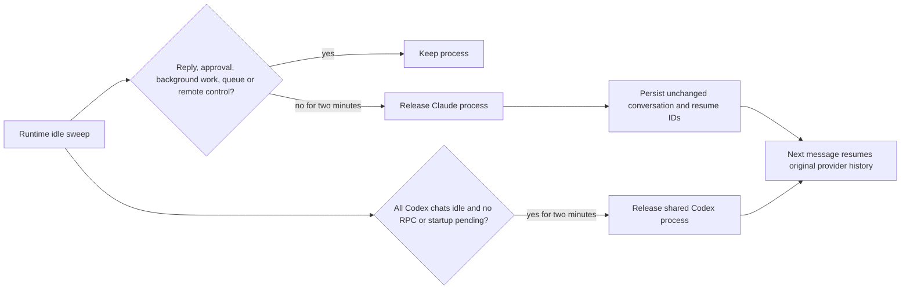

<!-- retained-tools-2026-10-13 -->
# Release idle agent tool processes

Completed attached chats retain their Claude processes and MCP servers; the shared Codex app-server retains loaded threads and tool helpers across days. The scan observed 680 host descendants and 14.13 GiB resident memory, with 465 descendants beneath one three-day-old Codex server. Host.tick only retires idle detached agents (ChatterboxHost/Host.swift).

Scope confirmed by Shelby: fix the buildup; go ahead now. Shelby explicitly approved an agent-host restart after all replies and background work finish. Keep active replies, pending approvals/questions, remote-control sessions, background tasks, and queued messages intact. Preserve provider session/thread IDs, transcripts, drafts, settings, and host reattachment. Only Chatterbox-created agent groups are signaled; no blind host termination. No unrelated UI changes, global CLI configuration, or forced live-host restart. The supported --host handoff waits for all child agents to retire and safe_stop refuses any nonempty host.

## Flow

## Success and deliverables
Idle attached Claude processes release after two minutes and resume the same session on the next message. Shared Codex releases only with all associated chats idle and no pending RPC/startup. Active, awaiting-user and background work survives sweeps. Verify with isolated provider/host integration tests and Mac build; deliver core commit, parent submodule commit pushed to GitHub, installed Mac app and idle-wait service activation. Mobile has no daemon ownership changes; verify compilation only if shared source changes affect its target.

## Tasks
- [x] T1 Implement runtime idle sweep, provider eligibility guards and isolated agent process-group cleanup; acceptance: no cleanup while any protected work is present.
- [x] T2 Add integration regression coverage for attached idle release and same-session resumption; acceptance: behavioral tests pass including protected work.
- [x] T3 Build, commit/push and install; acceptance: installed binaries match build, service activation recorded separately, existing chats preserved.

## Test and rollback
Run scripts/test-chatterbox-daemon.sh plus focused idle lifecycle integration checks; build Mac with build/DerivedData. This is nonvisual. Back up /Applications/Chatterbox.app and conversation runtime data before activation; revert the scoped commits/submodule pointer and reinstall through scripts/install.sh to roll back. No data migration. Preserve all unrelated repository work.

## Work preparation
Mode: linear, current session; exact model/effort unavailable. Reason: runtime/provider changes share lifecycle state and need sequential validation. Recipient: current session. Now authorized. Open questions: none. Readiness: pass R1-R13; R3 flow embedded; R12 rollback above. Issue URL: https://github.com/shelbyklein/chatterbox/issues/42

## Verification
Runtime integration passed on 2026-10-13: attached idle retirement, same-provider session resumption, transcript/draft preservation, background work, questions, pending approvals, queued messages, remote control, active host reattachment, and stubborn inherited-helper cleanup. Core commit: a1111f6. Parent implementation commit: 5bb7dde. Mac build passed; installed binaries match build and app reopened. Idle-wait service/Codex restart queued; no active host stopped. Host process-group changes take effect when a fresh host launches. Backup: /Users/shelbyklein/Library/Application Support/Chatterbox/Backups/idle-tools-20261013-123322. iOS build 202610131234 uploaded successfully; Apple processing pending. Approved empty-host handoff queued after service activation; protected agent work is never stopped. Runtime activation remains pending until this reply finishes.
