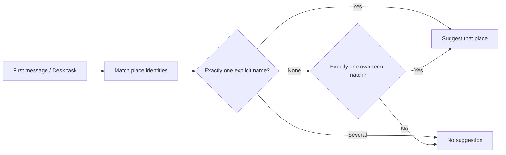

# Studio suggestions require identity evidence

Loose chats must not be labelled USA Archery merely because ordinary words overlap its long instructions. Suggest a place only from its name, a distinctive name term, a recognizable abbreviation, or a website explicitly named in its instructions/brief. Ambiguous identities produce no suggestion. The same shared rule applies to Desk place proposals.

## Work preparation

User confirmed scope and implementation now: “fix the studio suggestion: only suggest when the message names the studio or its own terms”, then “Continue”. Linear, current session; exact model/effort unavailable. No work threads. Local tracking: `local:plans/studio-suggestion.md`, continuing Core `9d8fa11` and root `3dfe7e8` from the interrupted agent. Readiness R1–R13 passes; no blocking questions. No layout change: the existing suggestion card and manual choices stay unchanged. The behavioral flow below is the visual for R3.

Evidence: prior matching counted arbitrary instruction words; interrupted implementation already removed that. Existing tests reproduce the unrelated cabin, phone case, icon and USA flag examples. Review also found that multiple full names could favor a longer name, which is not a clear identity choice.

Success: unrelated generic prompts suggest nothing; explicit names/own terms still work (including empty-instruction Studios); generic/shared/ambiguous identities suggest nothing; chat and Desk use the same helper. Behavioral tests establish the rule; there is no UI layout redesign.

Deliverables: shared matcher and regressions committed/pushed, related tests plus one full-suite attempt with failures reported, Dev install with idle-safe Dev restart, delivery evidence here. Preserve manual promotion, dismissed suggestions, existing assignments, task state and source gates. No real app install/restart until Shelby says ship. No new settings, model calls, instruction edits or data migrations.

- [x] S1 Review interrupted matcher, tighten ambiguity/identity edge cases; focused regression cases pass.
- [ ] S2 Run `scripts/tests-for.sh --run Core/Shared/PlaceSuggestion.swift tests/place-suggestion/main.swift` then `scripts/tests-for.sh --run --all` once; record failures rather than claiming a green suite.
- [x] S3 Core `69d6b3b` and root `679a31f` pushed, then source-link follow-up Core `9129261` / root `883f2db`. Mac Dev installed/reopened, Dev service healthy after 2s at 12:15:38 local. `scripts/tidy.sh` reported 144 removable/7 kept; no apply. Dev phone install failed to resolve Duo destination (exit 70); no phone installation or TestFlight claimed. Offer Ship only with full-run status disclosed.

Rollback: revert scoped matcher commit and reinstall Dev; no stored-data changes. Existing routes: Chats → new loose session → first prompt → suggestion card; Desk → new task → proposed place. The helper is shared by Mac, phone and Desk; focused logic and Desk service checks are the primary behavioral evidence.

Verification prerequisite: the full runner includes `test-vnc-spike.sh`, an interactive experiment that asks for the user's Mac password with no time limit. Gate that live check behind `CHATTERBOX_RUN_LIVE_VNC=1`; default full-suite execution must report SKIP and never prompt. This is a narrowly scoped unattended-test hygiene correction, also within the user's previously requested broken-test backlog. No password is supplied or read by this work. Readiness remains pass with this documented addition.

S1 evidence: `scripts/test-place-suggestion.sh` passes 30 behavioral checks (`build/studio-suggestion-targeted.log`). Includes cabin/icon/case/USA flag false positives, explicit Studio/project names, website stems, USAA abbreviation, shared-name ambiguity, multiple explicit names, generic-only names, generic infrastructure sites, and empty-instruction Studios. `check-sources.sh` and scoped diff checks pass. Full-suite run in progress in `build/studio-suggestion-full-suite.log`; per-script logs in `build/test-logs`.

Security hygiene found during full validation: 13 test scripts had a bare `export`, dumping all environment values. Removed those no-op dump commands, redacted the one affected local test log, and added a source guard rejecting bare `export` / `export -p` without executing them. A temporary dummy script verified rejection; all changed shell scripts parse. The RunCloud secret reached tool output, and ElevenLabs was present in the dumped environment; Shelby was told to rotate both keys. These values are not repeated here. The hygiene changes and live-VNC opt-in were committed/pushed separately as `2ef8026`.
