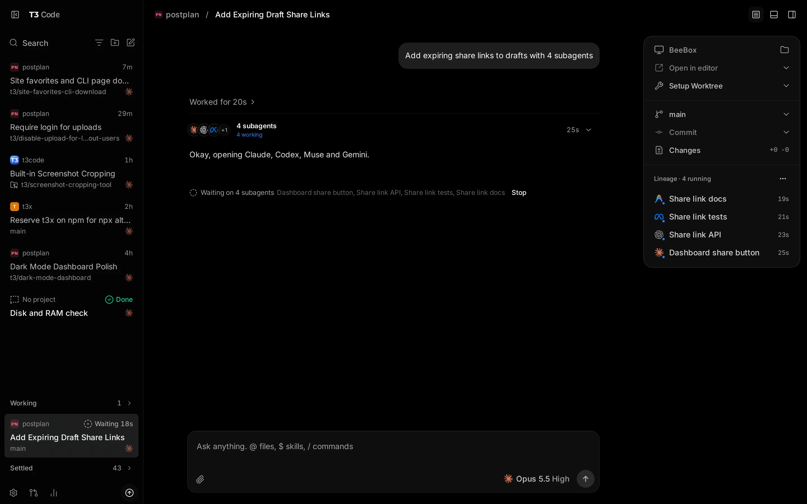

# T3 Code review: what Chatterbox can learn from it

Research only (Shelby, 2026-11-05). No Chatterbox code changed. Sources: the installed app
(`/Applications/T3 Code (Beta).app`, v0.1.7), its data in `~/.t3`, and its open-source repo
(github.com/pingdotgg/t3code, MIT, read at commit `67eebaca` of 2026-11-05, one day after the
v0.1.7 tag). File references to T3 are paths in that repo. I couldn't take screenshots of the
running app (see "Not checked" at the end). The one picture is T3's own marketing screenshot from
the repo: `design/t3-review/t3-marketing-desktop.png`.

## 1. What T3 Code is

- **Version and stack.** T3 Code (Beta) 0.1.7, `com.t3tools.t3code`, built by Theo and Julius
  (ping.gg). It's an Electron app. Inside it, a Node/TypeScript server built on Effect owns
  everything that runs, and a React web client talks to it over WebSocket RPC. The same server
  also serves `npx t3`, a hosted web app (app.t3.codes), and a React Native mobile app for iOS
  and Android. A Rust sidecar, `t3-resource-monitor`, reads process statistics.
- **Where it keeps data.**
  - `~/.t3/userdata`: one SQLite file, `statev2.sqlite`, opened in WAL mode, plus attachments,
    logs, secrets, `keybindings.json`, `client-settings.json` and a `compacted-at` stamp.
  - `~/.t3/worktrees` holds its git worktrees, and `~/.t3/scratch` holds the folders of threads
    that have no project.
  - Electron's own cache is in `~/Library/Application Support/t3code-v2`.
- **Scope.** It calls itself an "agent harness control surface": a GUI for your
  bring-your-own-subscription coding agents.
  - Providers: Codex, Claude, Cursor, Grok Build, OpenCode, Antigravity, Kiro, fx, Pi and Muse,
    plus any ACP agent.
  - The app is heavily git-centred: worktrees, per-turn checkpoints, diffs, PRs, and integrations
    with GitHub, GitLab, Bitbucket and others.
  - Remote use goes through T3 Connect (its own tunnel and account), Tailscale, LAN pairing, or
    desktop-managed SSH.
  - It also has a terminal, a browser panel, devices and simulators, scheduled and webhook tasks,
    usage and cost tracking, and an MCP server that other agents can drive.
- **How it runs agents.** Every provider sits behind one adapter interface
  (`packages/provider-core/src/server/ProviderAdapter.ts:607-718`): start, steer, interrupt,
  compact, rollback and fork a turn, answer requests, unload a thread.
  - **Claude:** the Claude Agent SDK, one long-lived `query()` per session with prompts fed from
    a queue. T3 chooses the session id itself so it can resume after a restart
    (`apps/server/src/orchestration-v2/Adapters/ClaudeAdapterV2.ts:1181-1186, 1803-1805`).
  - **Codex:** one shared `codex app-server` process speaking JSON-RPC, using `thread/start`,
    `thread/resume`, `turn/start`, `turn/steer` and `thread/fork` (`CodexAdapterV2.ts:1422, 1481`).
  - **Other agents:** ACP over stdio.
  - **Idle sessions:** released after 30 minutes idle, or held up to 4 hours while background
    work is running (`ProviderSessionManager.ts:57-58`).
  - No PTY: the terminal is a separate feature.
- **Mental model.**
  - **Environment:** one running server and its machine. **Project:** a folder.
  - **Thread:** a durable conversation. It can live in its own worktree or have no project at
    all. **Run:** one turn, made of a tree of execution nodes (tools, approvals, subagents).
  - **Provider thread:** the native session handle. A thread can hold several, so switching
    provider or model is a recorded "context handoff", not a new thread.
  - **Sidebar:** Pinned, Active, Working, Snoozed and Settled. There's no task board.

  

  In that screenshot, a thread has delegated to four subagents on four different providers. The
  thread shows "Waiting on 4 subagents … Stop", and the right panel lists the "Lineage · 4
  running" with a timer for each. The sidebar has a collapsed **Working** section and **Settled
  43**.

## 2. Side by side

| Dimension | T3 Code | Chatterbox | Stronger |
|---|---|---|---|
| Stack and footprint | Electron + Node server + React. With no threads open, its 6 processes added up to about 1.1 GB resident memory (measured 2026-11-05: main 320 MB, server 316 MB, renderer 322 MB, GPU 126 MB, network 60 MB) | Native Swift (SwiftUI) app + `chatterboxd` service + hosts. About 0.55 GB in real use (app 316 MB, service 156 MB, hosts 50 MB) | Chatterbox |
| Agents driven | 10+ providers behind one adapter interface, capability flags per provider | Claude (`claude -p` stream-json, one process per chat, in a host) and Codex (one shared `app-server`), each on the Mac, Shelby-PC or a remote machine | T3 for breadth. Same mechanism for Claude and Codex |
| Agents surviving restarts | Server restart → resumes by session id and replays persisted events (`RestartContinuation.ts`). In-flight provider processes are its children | Agents live in hosts. The service reattaches to them, so replies carry on through a service restart | Chatterbox |
| Sessions and threads | Threads in projects, or with no project (scratch folder, later "Turn into project"). Side chats (`/btw`) that can "Bring back" | Studios and projects; sessions, Sidechats, sidequests (to the other agent), work threads with a front thread | Even. Chatterbox's front/work threads are more deliberate; T3's provider-agnostic thread is more flexible |
| Delegation and parallel agents | Agent tools `delegate_task` (async or wait), `task_status`, `task_cancel`, `create_threads` (1–20), `t3_thread_send` (auto, queue, steer, restart), `t3_thread_wait`. A child can't get more permissions than its parent. A child's questions go to the parent. Stopping the parent stops its children. Lineage panel with timers | `work start/list/report`, sidequests. Work strip chips, peek column, results posted back into the front thread | T3 on control (send, wait, stop all, question routing); Chatterbox on the result-to-front-thread flow and its link to the Desk |
| Task tracking | None as such. Sidebar sections, PR links, auto-settle | The Desk board: To do, Working, Needs you, Ready, Done, with tasks linked to threads and place routing | Chatterbox |
| Finishing work | Settle (auto after 3 days idle or when the PR merges), Snooze until a time, Undo toast for 5 s, `runOnSettle` cleanup scripts | Mark complete (archives), Silence (until something new), Undo after silencing | T3 on automatic rules; Chatterbox's board is clearer |
| Worktrees and branches | Optional per-thread worktree, temporary `t3/<hex>` branch renamed by an LLM, `t3.json` setup and settle scripts, cleanup policies | Worktree sessions; branch shown in names; sidebar git status | T3 |
| Diffs and review | Per-turn checkpoints in hidden git refs, a diff for each turn, "Edit from here" with "Revert files too", PR creation, PR watch that wakes the agent, review guides | No checkpoints, rewind or diff view. Visual review: marks on images and PDF pages, on the Mac and the phone | T3 for code; Chatterbox for visual and document work |
| Approvals | 4 modes (Supervised, Auto-accept edits, Auto, Full access). An approval is a durable record that knows whether it can still be answered (`live`, `message`, `not_resumable`). Typed text declines it with feedback. A subagent's approvals appear in its parent | Permission modes; approvals and questions as cards; approve or deny from the Desk and the phone; Allow for Session | Even. T3 handles "this approval can no longer be answered" more explicitly |
| Model and provider choice | Per thread, changeable at any time with a budgeted context handoff (16k-token default). Shift-click several models to run the same prompt on each, in its own worktree | Per session; sidequest = the other agent; presets and favourites | T3 |
| Remote and mobile | React Native app (iOS and Android), push notifications, iOS Live Activities, offline message queue, guest read-only links, T3 Connect tunnel | Native iPhone/iPad app over Tailscale or the encrypted tunnel, APNs push, widget, Desk, Mac screen | Even. T3 has Live Activities and an offline queue; Chatterbox is native and shares the Desk |
| Long-session performance | Bounded everything: snapshots of about 10 turns, 75–500 rows or 1 MiB; older pages on demand; tool output bodies left off the wire; 50 ms coalescing; byte budgets in tests | The phone gets the last 300 rows, polled every 1.2 s while running; whole-transcript JSON rewritten on save; every chat loaded at service start | T3 (detail in §3, ideas 1–3) |
| Storage | One SQLite file: an event log kept for 1 day, plus summary tables for current state; full-text message search; compaction every 6 h, capped at 10% CPU | 459 JSON files, 41 MB, one per chat (largest 5.8 MB), each rewritten whole on save; `runtime-state.json` holds a 4,096-event ring | T3 |
| Keyboard | Every action can be rebound (`keybindings.json` with `when` conditions); F6 between areas; ↑ recalls sent prompts; ⌘S stashes a prompt; ⌘↩ = the opposite of queue/steer; ⌘Z undoes the last sidebar action | ⌘K switcher and actions, ~49 shortcuts, in-chat find | T3 |
| Notifications | Finished, failed, approval and input, separately per device; quiet while the app is in front; Live Activities | APNs push, the finished-chat bell, Desk badges, menu bar | T3 slightly (Live Activities, per-kind choice) |
| Search | ⌘K over titles, branches, PRs and projects, plus **message text** (opens at the match); ranks by recent and frequent use | ⌘K over names, titles, tags and agents; find within a chat | T3 |
| Diagnosing itself | "Triage an issue": an agent reads its logs and the T3 source of the running version. Resource monitor in Settings → Diagnostics | Diagnostics settings, hang and freeze watchdog, service-restart reports, SimulatorSweeper, build lock | Even |
| Non-code work | Code-first: no-project scratch threads, HTML renders | Studios, Desk routing, PC errands, drafts and action cards, images, PDFs, secrets masking | Chatterbox |

## 3. Ideas worth borrowing, ranked for Shelby's way of working

Ranked by what helps most with many agent sessions at once, Mac plus iPhone, project front
threads with work threads, the Desk, and the recent load and responsiveness problems.

### 1. Stop rewriting whole transcripts; load history on demand (performance)

- **T3 Code:**
  - Keeps one SQLite database in WAL mode with `synchronous=NORMAL`.
  - Each change is appended as a small row: events plus summary tables, with a position for each
    item.
  - Startup reads only the navigation rows and what's needed to recover running work; completed
    history isn't loaded "merely to discover that no work remains"
    (`docs/internals/performance-regressions.md`, "Event store and startup").
  - Text that's still streaming isn't written at all until a paragraph is finished
    (`RunExecutionService.ts:1318-1320`).
  - Diffs are cut to 32 KB before they're stored (`WireProjection.ts:33-46`).
- **Chatterbox today:**
  - `ConversationRuntime.init` decodes **every** `Conversations/*.json` file fully at service
    start: 459 files, 41 MB (`Core/ChatterboxRuntime/ConversationRuntime.swift:101-110`). Every
    `ChatSession` then keeps its whole transcript in memory.
  - While a reply streams, `flushSoon` saves at most once a second. Each save re-encodes the
    chat's **entire** record and writes it atomically (`ConversationRuntime.swift:344-360, 489-500`).
    For the largest chat that's 5.8 MB every second it's streaming.
  - Commit d80e90a moved this off the main thread, which helped responsiveness, but the CPU and
    disk work is still there and grows with each chat's length.
- **Change, in two steps:**
  - **(a) Split each chat's record (M).** Keep a small header JSON (summary, settings, state) and
    put the items in an append-only log, one JSON line per item change. Rewrite the log only on
    compaction, for example when it grows past twice its live size. At startup, read only the
    headers; read items when a chat opens, runs or recovers. Drop a chat's items from memory a few
    minutes after it was last viewed, as T3 does with `threadRetention.ts`.
  - **(b) Move to SQLite later (L), if wanted.** Use one SQLite file with WAL: `chats(id, header…)`
    and `items(chat, seq, json)`, plus an FTS index that also gives idea 5. Don't copy T3's full
    event sourcing (see §5); plain tables are enough.
- **Risk:** medium. This is a storage migration, so keep a JSON export, back up first, and keep
  the reader for the old format. Anything that walks `session.items` for every chat (the Desk,
  summaries, search, `pendingByChat`) has to read from the header or an index instead.

### 2. Phone sync: send changes, not the last 300 rows every 1.2 seconds (performance)

- **T3 Code:**
  - When a client subscribes, it gets a bounded snapshot and then a live tail of whole-item
    updates. In each 50 ms window, only the newest update per item is kept
    (`ThreadLiveEventCoalescer.ts:18-19, 50-77`).
  - Each subscriber has a budget of 1,000 items and 8 MiB; past that, the client resumes from its
    last sequence number (`LiveStreamBudget.ts`).
  - A resume replays at most 128 events and 1 MiB, otherwise it sends a fresh snapshot
    (`ThreadStream.ts:18-23`).
  - Text is released by paragraph, at most every 400 ms (`assistantStreaming.ts`).
  - The send path dropped from about 10.4 MB of JSON to 1 KB or less
    (`commands.performance.test.ts`).
- **Chatterbox today:**
  - While a chat is running, the phone polls `/v1/chats/<id>?since=<revision>` every 1.2 s
    (`Core/ChatterboxMobile/ChatListView.swift:171`).
  - Whenever anything changed, which is every poll while streaming, the reply is the whole
    `ChatDetail` with up to `Companion.itemLimit = 300` rows
    (`Core/Shared/CompanionAPI.swift:12`; `CompanionServer.detail`, `Core/Chatterbox/Engine/CompanionServer.swift:1019-1045`).
    It also rebuilds options, commands, next steps and work every time.
- **Change (M):**
  - Add `?since=<revision>&delta=1` returning only the rows changed or added since that revision,
    their ids, and the summary. The service already numbers changes (`RuntimeEvent` sequence and
    revisions per chat); it needs a revision on each row, or a small per-chat log of changed row
    ids.
  - Fall back to the full window when the revision is too old.
  - Make the slow parts (options, commands, next steps) separate calls, or send them only when
    they change.
  - Optionally, later: long-polling or server-sent events instead of the 1.2 s timer.
- **Risk:** low to medium. Older phones keep the full response. Test with the 20k-row fixture in
  `tests/service-responsiveness`.

### 3. Keep tool output off the transcript path (performance)

- **T3 Code:**
  - Raw command output and the bodies of tool results and file changes are left out of the
    transcript snapshot and its updates, even when small.
  - Live output goes to a separate per-command channel (100 ms frames, 64 KB tail) that only an
    *expanded* row subscribes to (`CommandOutputHub.ts:32-41`;
    `performance-regressions.md`: "Do not route output deltas through `turn_item.updated`: a busy
    command would flood the event store").
  - Groups of more than 150 finished tool items load only when expanded (`threadHistoryPaging.ts`).
- **Chatterbox today:** tool output is part of each item. It gets saved with the transcript,
  diffed into the phone's 300-row window, and repeated on every poll while it streams.
- **Change (M):**
  - Store and send a tool item's output as a separate body, with a short preview and its size.
  - Fetch the full output when the row is expanded, on the Mac and the phone.
  - On the Mac, update a running command's output only for the row that's on screen and expanded.
- **Risk:** low. It's a display change, and the agent's own context is unaffected.

### 4. The front thread as a real controller for its work threads

- **T3 Code:**
  - While children run, the parent shows one line, "Waiting on 4 subagents: A, B, C, D — Stop",
    and a **Lineage** panel lists each child with its agent and running timer (marketing
    screenshot).
  - Agents have `t3_thread_send` (auto, queue, steer, restart) to follow up with the *same* child,
    `t3_thread_wait` (which ends early when the child has a question or approval), and
    `task_cancel` (`apps/server/src/mcp/toolkits/orchestrator/tools.ts:228-452`).
  - Stopping the parent stops its children (`docs/user/thread-sidebar.md`, "Inspect agent work").
  - A child's questions are steered into the parent's running turn, or queued
    (`docs/orchestration-v2/orchestrator-mcp-server.md:515-530`).
  - A child can't get broader permissions than its parent, and `clientRequestId` makes retries
    safe.
- **Chatterbox today:** `work start/list/report`, the Work strip (chips with their state) and the
  peek column. The front thread can't message a running work thread, wait on one, or stop it, and
  a work thread's question shows on the Desk, as its chip's state in the Work strip, and in the
  work thread itself, but nothing appears in the front thread's conversation.
- **Change (S–M):**
  - **(a)** A one-line status in the front thread while any of its work threads run: "Waiting on
    2 work threads: X, Y", with Stop all. Put each chip's elapsed time in the strip.
  - **(b)** Add `work send "ID" "TEXT" [--steer]`, so the front agent can follow up in the same
    work thread instead of starting a new one, and `work stop ID`.
  - **(c)** When a work thread is in Needs you, also post a short notice into its front thread,
    so Shelby sees it in the conversation they're already in.
  - **(d)** A work thread's permission mode can't be broader than its front thread's.
- **Risk:** low. Stop all and steer need the existing approval rules: an agent may stop or steer
  only its own work threads.

### 5. Message search in ⌘K

- **T3 Code:** ⌘K finds threads by title, branch, PR or project, and under "In messages" by any
  message containing all the typed words; picking one opens the thread at that message. Results
  rank by frequent and recent use, and for three weeks the thread last picked for the same query
  ranks higher (`docs/user/thread-sidebar.md`, "Find and reference work"). It's backed by an FTS
  table that skips messages still streaming (`messageSearchIndex.ts:55-81`). Phone search does
  the same.
- **Chatterbox today:** ⌘K matches names, titles, tags and agents only
  (`Core/Chatterbox/Views/QuickSwitcher.swift:3`). With 459 chats, "which chat decided X" is
  hard to answer.
- **Change (M):** a service-side index of user and assistant message text (FTS5 once idea 1(b)
  lands, or a small inverted index), a socket operation and a companion route, an "In messages"
  section in ⌘K and in the phone's search, and open at the matching row.
- **Risk:** low. Leave secrets out of the index (use the masked text).

### 6. Desk housekeeping: automatic Done, snooze until a time, Undo

- **T3 Code:**
  - Threads settle on their own after 3 days idle or when their PR merges. Pending questions,
    approvals and background work prevent it, and each thread can opt out.
  - Snooze takes a time ("9:00 PM tomorrow" or a custom one). A snoozed thread comes back early
    on an approval, a question, a failure, or a new message.
  - Settle, snooze, unpin and archive each show a 5-second Undo, and ⌘Z triggers the latest one.
  - `runOnSettle` scripts (for example `cargo clean`) free disk space in that thread's worktree.
  - The rules run on the server even when no app is open (`ThreadSettlementService.ts`).
- **Chatterbox today:** Ready keeps a task "however long ago it finished" (plans/work-threads.md,
  "Chosen while building"). Silence lasts until something new happens; there's no wake time.
  There's Undo after silencing.
- **Change (S–M):**
  - A service rule: a Ready task idle N days (default 3, a Settings choice) moves to Done, as
    Mark complete does, with a "Completed automatically" note.
  - "Silence until…" with times, and a wake on anything new, as today.
  - Undo on Mark complete too.
  - Optional for projects: an `onComplete` command to clean up a work thread's worktree.
- **Risk:** low. Shelby may want Ready to stay until it's decided by hand, so make the automatic
  part a setting and ask Shelby about the default.

### 7. Usage limits: resume at reset

- **T3 Code:** a turn that hits a limit is marked **Limited**. Shelby can choose **Resume at
  reset**, which schedules the continuation and survives restarts, or **Snooze until reset**. A
  setting makes either one automatic. Queued messages wait and then run
  (`docs/user/thread-sidebar.md`, "Inspect agent work").
- **Chatterbox today:** usage meters and proxy quotas exist. I didn't find an automatic resume
  after a limit resets.
- **Change (S–M):** when Claude or Codex reports a limit and its reset time, show "Resume at
  reset" on the session (and on the Desk card), schedule it in the service, and cancel it if
  Shelby sends, stops or archives first.
- **Risk:** low.

### 8. A "what's using the Mac" view, sampled only while it's open

- **T3 Code:**
  - The Rust sidecar samples the process table, and only while the Diagnostics view is open; with
    no viewer the interval is 0.
  - It samples less often on battery, when the screen is locked, or when the Mac is hot.
  - It shows CPU and memory grouped by agent kind (codex, claude, browser, terminal…).
  - History is bounded by age, count and bytes (`docs/internals/resource-telemetry.md`;
    `NativeTelemetryClient.ts:42-46`).
- **Chatterbox today:** the build lock, SimulatorSweeper and the hang watchdog came after the
  Mac hit a load average of 120. Nothing shows which *chat* is eating CPU.
- **Change (M):** the hosts already know each chat's process. Add a Diagnostics page (and
  optionally the menu bar) listing each chat's process tree CPU and memory, with Stop on a runaway
  `xcodebuild` or dev server. Sample with `proc_pidinfo` only while it's visible.
- **Risk:** low. Use `safe_stop` rules for any Stop button.

### 9. Budgets as tests

- **T3 Code:** `test:perf:v2-wire` asserts bytes and rows (a sidebar row under 2 KB, a send of
  1 KB or less, a page within 1 MiB). `report:renders` counts React re-renders for "stream a
  reply", "switch thread" and "type in the composer", and fails on differences between runs.
- **Chatterbox today:** `scripts/test-service-responsiveness.sh` checks save time and request
  latency, which is a good start.
- **Change (S):** add byte budgets to it: the phone's detail response and the size of a running
  chat's delta, for ideas 2 and 3. Add a Mac render check that counts transcript row rebuilds per
  streamed token.
- **Risk:** none.

### 10. Live Activities and per-kind notifications on the iPhone

- **T3 Code:** a Live Activity follows a running thread and shows its result for 15 minutes;
  alerts can be chosen separately for finished, failed, needs approval and needs input; alerts
  stay quiet while the app is in front (`docs/user/mobile-notifications.md`).
- **Chatterbox today:** APNs push and a widget; no Live Activity (no `ActivityKit` in Core).
- **Change (M):** one Live Activity for "Working: N, Needs you: M" (the Desk's counts), updated by
  push. Tapping it opens the Desk.
- **Risk:** low. It needs ActivityKit push tokens in the existing APNs path.

### 11. Composer details

All from `docs/user/composer.md`, effort S each:

- **Queue or steer per message:** a setting picks the default, ⌘↩ does the other, and holding ⌘
  changes the send button. Chatterbox has queued messages with Send Now and Codex `turn/steer`;
  it needs a visible choice.
- **↑ in an empty composer** recalls earlier prompts in this thread.
- **⌘S stashes the draft** for later.
- **"Resume" in an empty composer** after a stop or a restart continues a held queue.

### 12. Better context for sidequests and work threads

- **T3 Code:** handing a thread to another provider sends a *budgeted selection* of real messages
  (16k tokens by default): the original request and the recent turns, kept whole, never an
  agent-written summary. The new request is never cut. Omitted parts are listed as references the
  agent can read with a tool (`docs/user/portable-handoffs.md`).
- **Chatterbox today:** a sidequest reads the whole parent conversation; a work thread gets only
  its brief.
- **Change (M):** give sidequests the same budgeted selection, plus a `chat read <id> [--from N]`
  command for the rest. Let a work thread run `chat read <front thread>` when its brief isn't
  enough.
- **Risk:** low.

### Lower priority, noted

- **Per-turn checkpoints with "Edit from here" and "Revert files too" (L).** T3 snapshots each
  turn under hidden git refs and refuses to restore files when another session shares the folder.
  It's valuable for code projects, but most of Shelby's work happens in Studios and shared
  folders, so it's worth it only if code projects become the main use.
- **Same prompt to several models (M).** Shift-click several models; each runs in its own thread
  and worktree. Fun for comparing Claude and Codex, but not a daily need.
- **Watch a PR and wake the thread (M).** T3 polls every 2 minutes and wakes the thread on a CI
  failure, a comment or a conflict. It fits the GitHub pin and issue work if that grows.
- **No-project scratch threads that become a project (S).** Chatterbox's loose chats are close
  already.

## 4. Things Chatterbox already does better (keep them)

- **Native and lighter.** Chatterbox uses about half the memory of an empty T3 Code (§2). Don't
  move toward web views for the transcript.
- **Agents survive service restarts.** Hosts keep `claude` and `codex` running while
  `chatterboxd` restarts and reattaches. T3's server owns its provider processes and has to
  resume them by id.
- **The Desk.** T3 has no task concept, only sidebar sections. Chatterbox's tasks linked to
  threads, place routing (Studios and projects), Needs you with actions on the card, and the
  board on Mac and phone are a better match for Shelby's day.
- **Front and work threads with results posted back**, plus the Desk link and the peek column.
  T3's subagents are similar, but they're agent-driven and code-centred.
- **Non-code places and kinds of work.** Studios, PC errands (Windows apps and GPU), sidequests
  to the *other* agent, draft and action cards, visual review marks on images and PDFs, and
  secrets masked in transcripts.
- **Chatterbox Dev beside the real app** (`Flavor.swift`). T3 only has nightly and dev icons; its
  agents are warned not to touch the live `~/.t3/userdata`.
- **Plain-language product.** T3's docs and settings sprawl (Labs flags, "Boring sidebar",
  several legacy modes). Chatterbox's smaller surface is easier to live in.
- **Faster idle release.** Chatterbox releases idle agents after 2 minutes
  (`ConversationRuntime.swift:77`), against T3's 30, which suits a Mac under load. The price is a
  cold start on the next message.

## 5. Things NOT to copy

- **Electron and a web client.** That's T3's way of reaching Windows, Linux and the web, and it
  costs about 1 GB at idle. Chatterbox serves one person on Apple devices.
- **Full event sourcing with summary tables, 1-day pruning and rebuilds.** T3 needs it for many
  clients, many servers and idempotent remote commands. For Chatterbox, plain tables or
  append-only logs (idea 1) get the performance without the machinery. Theo's own note in T3's
  AGENTS.md says "do not introduce machinery because it looks architecturally impressive".
- **Ten providers and capability flags for each.** Claude and Codex are the ones Shelby uses.
- **A worktree for every thread by default, and LLM-named branches.** Most of Shelby's sessions
  aren't feature branches. Keep worktrees opt-in.
- **T3 Connect (an account and a cloud relay).** Chatterbox's Tailscale and its own tunnel keep
  everything on Shelby's machines.
- **Automatic compaction of idle Claude threads** (`IdleCompaction.ts`: `/compact` before the
  prompt cache expires). It spends tokens and changes context without asking.
- **Paragraph-held streaming on the Mac.** Holding text until a paragraph is complete helps the
  wire and storage, but on the Mac it can feel laggy. Use it for the phone's delta feed
  (idea 2), and coalesce Mac UI updates (about 50 ms) instead.
- **Settings sprawl.** Per-device toggles, Labs flags and legacy modes. If an idea needs a
  setting, pick one good default.

## Not checked

- **Screenshots of the running app.** `screencapture` failed ("could not create image from
  window"), because this shell has no Screen Recording permission. T3 was already running, opened
  at 01:57. I didn't sign in, start agents, or change its settings; its database was read
  read-only, table names only. The picture above is T3's own marketing image from the repo.
- **The app's bundled code.** I didn't unpack `app.asar`. I read the repo at `67eebaca`, one day
  newer than v0.1.7, so a few details may be newer than the installed build.
- **Behaviour I didn't watch run:** T3's mobile app, T3 Connect, its real streaming smoothness,
  and memory with long threads.
- **Chatterbox limit handling.** The claim that it has no automatic resume after a usage limit
  comes from a code search, not a live check.
